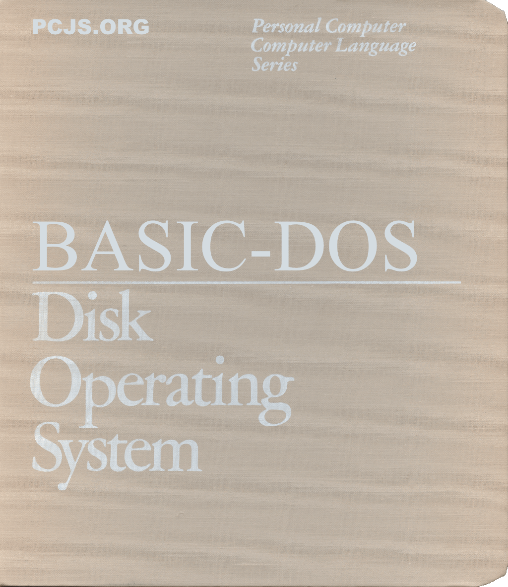

# PC DOS Reimagined

Read the [Blog](blog/), check out the [Preview](preview/), see a few of the original [Demos](demos/), and then [Download](#download) the first release.

## Download

The first BASIC-DOS release diskette is a bootable 360K diskette with BASIC-DOS, a "basic" set of utilities, a collection of BASIC samples (all from PC DOS 1.00), and a few demo programs.  See it running on the [BASIC-DOS Release](download/) page, or download [BASICDOS-360K](software/disks/BASICDOS-360K.img), a diskette image that most PC emulators can boot, or which can be written to a genuine 360K diskette.

When we say that BASIC-DOS comes with a "basic" set of utilities, we mean that both figuratively and literally, because while some are written in assembly language, most are in fact written in BASIC, including [CHKDSK](docs/bdman/cmd/external/#chkdsk), [FORMAT](docs/bdman/cmd/external/#format), [MODE](docs/bdman/cmd/external/#mode), and more.  BASIC-DOS takes it commitment to BASIC integration, performance, and ease-of-use very seriously.

## Project Status

BASIC-DOS began as a technology demo: a reimagining of what the first IBM PC operating system *could* have been, with a unified DOS and BASIC command interpreter, preemptive multitasking sessions, and other features that PC DOS wouldn't offer for years (if ever).  The goal now is to turn it into a usable product.

It is not a goal to provide every PC DOS function, or to be 100% compatible with PC DOS.  BASIC-DOS implements what its own commands and BASIC programs need, plus enough of the PC DOS API to run typical DOS programs, so unchecked items below are possibilities, not commitments.

This section tracks what's been completed (**[x]**) and what remains (**[ ]**).  Items marked *partial* work, but with known gaps.

### Boot and System Configuration

- [x] Boot sector that loads the BASIC-DOS drivers, kernel, and interpreter
- [x] Boot prompt when a hard disk is detected (press **Esc** within 2 seconds to boot from it)
- [x] Booting BASIC-DOS from a hard disk partition (eg, a disk built with `pc.js --sys=bd:2`), which becomes the default drive
- [x] CONFIG.SYS support for AUX, BUFFERS, CON, DEVICE, FILES, MEMSIZE, PATHCHAR, PRN, SESSIONS, SHELL, SKIP, and SWITCHAR
- [x] CON, AUX, and PRN are names for each session's console, AUX, and PRN devices rather than drivers: [CON=](docs/bdman/cfg/#con) defines each session's console (VKD$ or a serial port), and [AUX=](docs/bdman/cfg/#aux) and [PRN=](docs/bdman/cfg/#prn) choose any device (COM1 and LPT1 by default); without one (eg, no LPT1), opening the name fails, and its handle stays reserved
- [x] SKIP= lists built-in drivers (by their exact device names, separated by commas) that should not be loaded (eg, `SKIP=VKD$,FPU$`); a skipped driver is never initialized, and its memory is reclaimed
- [x] Installable device drivers (DEVICE=)
- [x] Critical ("hard") error handling: block device errors go to the session's INT 24h handler (called on a DOS stack, with PC DOS inputs and responses), and the default handler displays the traditional "Abort, Retry, Ignore, Fail?" prompt (see [Critical Errors](docs/bdtech/dos/#critical-errors))

### Device Drivers

- [x] VKD$ (video and keyboard), with multiple console contexts (one per session)
- [x] COM, LPT, NUL, CLOCK$, and PIPE$ devices
- [x] *partial*: CPU$, loaded first: it records the processor type (8086, 80186, 80286, or 80386) in CPU_TYPE, and on an 80286 or later with extended memory, it stays loaded, enables A20, and manages a physical memory arena and protected-mode descriptors (GDT and LDT selectors for allocated or existing memory), but BASIC-DOS itself still runs in real mode (see the [design](docs/bdtech/mmu/))
- [x] CLOCK$ starts with the BIOS time of day and, on a PC AT, the real-time clock's date
- [x] Loadable character drivers via `DEVICE=` in CONFIG.SYS, including [DEBUG.COM on a serial port](demos/debug/at/), with an 8086 disassembler, single-stepping, 9 breakpoints, SYMDEB-style memory dumps, memory and register editing, and exclusive ownership of its COM port
- [x] MOUSE$, a serial mouse driver (loaded only if a Microsoft-compatible mouse responds on a COM port at boot), with a minimal INT 33h interface (functions 00h-04h, 07h, 08h, and a BASIC-DOS function that returns queued button events), and a pointer drawn in MDA and CGA modes that preserves anything drawn over it
- [x] Interrupt-driven, asynchronous I/O for VKD$ and COM (COM ports also report how many bytes are waiting, with IOCTL_INSTATUS, for BASIC's EOF, LOC, and INPUT$)
- [x] Non-ASCII keys (eg, cursor and function keys) are returned as a zero followed by the key's scan code, as in PC DOS (for VKD$, and for VT100 terminals on COM ports), so INKEY$ sees them as BASICA programs expect (eg, F10 in COMM.BAS); the DOS line editor maps the keys it uses to its editing keys, and raw keys mode only turns hotkeys like CTRL-C into ordinary keys
- [x] Floppy disk reads, including multi-track requests and requests that cross 64K boundaries
- [x] Floppy disk writes
- [x] Media check and BPB rebuilds (reads PC DOS 1.x and 2.x diskettes)
- [x] *partial*: Hard disk reads and writes (HDC$), for the FAT12 primary partitions of up to two PC XT or PC AT hard disks, which become drives C:, D:, etc. (drives A: and B: are always reserved for diskettes); a disk with no FAT partitions (eg, a new disk) is still given a drive letter (with "unknown media"), and IOCTLs return its geometry and partition table (IOCTL_GETPART) and write a new MBR with the driver's own boot code (IOCTL_SETPART), so that FORMAT can partition it
- [x] Diskette formatting: IOCTL_SETPARMS gives a volume its BPB (so that an unformatted diskette can be written) and IOCTL_FORMAT formats and verifies a track, with the DPT's sectors per track set from the BPB (for every diskette transfer, so 8-sector diskettes read correctly, too); see FORMAT.BAS under [Utilities](#utilities)

### Kernel: Processes, Memory, and Sessions

- [x] COM and EXE program loading, PSPs, EXEC, and exit codes
- [x] Memory allocation (MCBs), including per-program heap requests, and allocation from the top of memory (MCBTYPE_HIGH), which the interpreter uses for its own blocks so that the memory below them stays contiguous
- [x] DOS_UTL_QRYMEM queries any memory block, or the highest free block (which COMMAND.COM uses to keep a copy of its transient portion while a program runs)
- [x] INT 32h utility functions numbered contiguously (00h-24h) and grouped by purpose (see the [Technical Reference](docs/bdtech/util/))
- [x] Preemptive multitasking of multiple sessions
- [x] CTRL-C/CTRL-Break handling, and CTRL-ALT-DEL session aborts (vectors 08h, 09h, 1Bh, and 1Ch that a terminated program left hooked, like MSBASIC's, are restored)
- [x] Session END: abort the current program in a specified session, interrupting any pending wait; WAITEND waits for the session to close
- [x] Environment segments for EXEC (EPB_ENVSEG; zero inherits the parent's), and COMMAND.COM gives every program an environment with COMSPEC and PATH
- [ ] TSR support (INT 27h and INT 21h function 31h; currently NOT under consideration for inclusion in BASIC-DOS)

### Kernel: File System

- [x] FAT12 and FAT16 file systems with read/write support
- [x] Handle-based open, read, seek, IOCTL, and close
- [x] Find first/next, disk info (free space), and current drive/DTA
- [x] Handle-based file creation (function 3Ch) and writing (function 40h)
- [x] File deletion (function 41h) and renaming (function 56h)
- [x] FAT cluster allocation and freeing
- [x] Write-back of modified FAT and directory buffers (every FAT copy is updated), including when the buffer is reused, on file close, disk reset, and restart
- [x] FCB support: open, create, close, sequential, random, and random block reads and writes, find first/next, delete and rename (with wildcards), file size, set relative record, and filename parsing (functions 0Fh-17h, 21h-24h, and 27h-29h), including extended FCBs and device names
- [x] Truncating/extending a file with a zero-length write (function 40h, and FCB function 28h)
- [x] Subdirectories: paths (separated by `\`, or `/` when PATHCHAR is `/`) in all file functions, MKDIR and RMDIR (functions 39h and 3Ah), subdirectories that grow as needed, and per-session current directories for every drive (CHDIR and GETCWD, functions 3Bh and 47h)
- [x] Same-drive file and directory moves (function 56h): preserve contents and metadata, update a moved directory's `..` entry, retain active current directories, and reject moves into itself or a descendant
- [x] Absolute disk reads and writes: opening a volume (eg, `C:`) as a file gives read/write access to its sectors, in place of INT 25h and INT 26h; a volume can also be created (ie, opened FOR OUTPUT) and opened when its media is unknown (eg, an unformatted diskette), with no critical error prompt, and IOCTLs on a volume handle go to the drive's driver (with their errors returned to the caller)
- [x] Configurable disk buffer cache (BUFFERS=2-32, default 2), with least-recently-used replacement for FAT and directory sectors; file data is transferred directly by the disk drivers
- [x] File attributes: a read-only file can't be opened for writing, replaced, or deleted; getting and setting a file's attributes (function 43h) and a handle's time and date (function 57h, kept when the file is closed); and on every BASIC-DOS disk, BASDEV.COM and BASDOS.COM are read-only hidden system files and COMMAND.COM is a read-only system file; BASIC's OPEN FOR RANDOM opens a read-only file for reading (as MSBASIC does)
- [ ] Extended disk partitions (currently NOT under consideration for inclusion in BASIC-DOS)

### Command Interpreter: DOS Commands

- [x] CD, COPY, DATE, DEL, DIR, EXIT, HELP, KEYS, MD, MEM, RD, RESTART, TIME, TYPE, and VER
- [x] DIR listings begin with the volume label and the directory's full path, as in DOS 2.x (FFIRST with attribute 08h finds only the volume label, and GETCWD with DL = FFh returns the path of the directory FFIRST searched)
- [x] DIR /A lists hidden files (only the hidden attribute keeps a file out of DIR, so system files like COMMAND.COM are listed), DIR /S lists the matching files in every subdirectory, with a header and totals for each directory, and DIR /W lists only the names (eg, HELP.TXT, with the path character after each directory), in as many 16-character columns as the console has room for
- [x] The prompt displays the current drive and directory (eg, `C:\SUBDIR>`), and switches use `/` (eg, `TIME /P`), as in PC DOS, unless SWITCHAR is `-` or PATHCHAR is `/`, in which case they use `-`
- [x] Running COM, EXE, BAT, and BAS files, and loading programs into other sessions
- [x] BAT and BAS files can run other BAT and BAS files and then continue (no CALL command required); a nested BAS file gets its own variables
- [x] Pipes (`|`) and output redirection (`>` creates or truncates the output file, `>>` appends to it), including redirection at the end of a pipeline (eg, `DIR | SORT > TEST`)
- [x] Input redirection (`<`) for the first command on a line, after its arguments and before any `|` or `>` (eg, `SORT /R < NAMES.TXT > SORTED.TXT` or `SORT < NAMES.TXT | MORE`)
- [x] `:>` and `:>>` redirect the output of an entire line, including BASIC statements, where `>` means "greater than" (eg, `PRINT "hello world" :> TEST`), at the prompt and in BAT and BAS files
- [x] At the prompt, a line of BASIC statements can end with a pipe (eg, `FOR I=1 TO 100:PRINT 3.14^I:NEXT | MORE`); the statements run once the rest of the pipeline has started, and a runtime error still ends the pipeline's input
- [ ] Pipes after BASIC statements in BAT and BAS files (currently only at the prompt)
- [x] A BAT or BAS file can be the first command of a pipeline (eg, `LS | MORE`): like a built-in command, it runs once the rest of the pipeline has started, so it can't fill the pipe before anything reads it, and its ARG$ ends at the `|`; a deferred command that fails (eg, `TYPE NOFILE | SORT`) sets ERRORLEVEL to 1.  A BAT or BAS file can't come after a `|` (it would have to run in the first command's session), so that's an error (eg, `DIR | TEST.BAS` reports "Unable to open TEST.BAS")
- [x] COPY creates (or truncates) the output file, and refuses to copy a file onto itself
- [x] A DOS command (internal or external) ends at a colon that begins a word, so other commands can follow it on the same line (eg, `DIR *.BAS : PRINT "done"`), at the prompt and in BAT and BAS files
- [x] A command that fails (internal or external, eg, "Unable to find" or "Unable to open") ends a BAT or BAS file; a program's non-zero exit code doesn't (use ERRORLEVEL)
- [x] Any DOS command that accepts a file name (eg, COPY, DEL, DIR, LOAD, SAVE, TYPE, CD, MD, RD), and any redirection (`<`, `>`, `>>`, or `:>`), also accepts a string variable whose value is the file name (eg, `DIR D$`, `COPY CON NAME$`, or `DIR > F$`), and quoted file names (eg, `TYPE "TEST$"`); expressions aren't evaluated, so DEL reports a syntax error for anything after the file name (eg, `DEL "TEMP" + N$`); see [Command Arguments](docs/bdman/lang/#command-arguments) for how BASIC statements and external commands differ
- [x] External commands receive the values of string variables in their arguments (eg, `FORMAT D$` or `FIND S$ *.TXT`), quoted if they contain spaces
- [x] DEL/ERASE
- [x] ECHO ON/OFF and the `@` prefix in BAT files: every BAT file starts with ECHO OFF (unlike PC DOS, so BAT files behave like BAS files unless ECHO ON is used), echoed lines are displayed with a `@` in front, and a leading `@` is ignored at the prompt, too
- [x] A BAS file run from the command prompt remains loaded when it ends, along with its variables (like MSBASIC), so it can be LIST'ed or RUN again; RUN reuses the program's compiled code once it has all been compiled (even if CTRL-C stopped the last run), unless the program or its variables have changed since, so it starts immediately
- [x] Resident and transient portions: before running a COM or EXE file, COMMAND.COM frees idle variable blocks and discards its transient portion (about 23K), restoring it when the program ends (from a copy at the top of free memory, if the program didn't overwrite it, or else from COMMAND.COM); MEM includes the transient portion in its free memory total
- [x] Filters: FIND (/C, /I, /N, /R, /V), MORE, SED (/I, /N), SORT (/R, /+n), TEE (/A), TR (/C, /D, /S), UNIQ (/C, /D, /I, /U), and WC (/L, /W, /C); FIND, MORE, SED, SORT, UNIQ, and WC also accept file names, FIND's string and SED's script need quotes only if they contain spaces, and every filter treats CTRL-Z as the end of input
- [x] Regular expressions in the style of UNIX `ed` and `sed` (`.`, `[...]`, `[^...]`, `*`, `^`, `$`, `\(...\)`), shared by FIND /R and SED, whose scripts have line-number, `$`, and `/regex/` addresses (and ranges and `!`) and the s (with `&`, `\1`-`\9`, g, and p), d, p, q, and = commands
- [x] Pipelines with more than one filter (eg, `TYPE FILE | SORT | MORE`): when a session ends, its output pipe receives end-of-input
- [x] Pipe reads return as soon as some data is available (like UNIX pipes), so a filter such as MORE displays a pipeline's output as it's produced, instead of a buffer at a time
- [x] When any command of a pipeline fails (eg, a program that can't be found, or no session available for it), the error is reported, the commands already running in other sessions are ended (DOS_UTL_END), and the first command never runs; and when a command stops reading a pipe early, the command writing to it gets a write error instead of waiting forever
- [x] LIST VARS: list preserved strings (including PATH$), scalar values, and array dimensions in the current session
- [x] PATH$: the directories searched for programs (eg, `PATH$="A:\;A:\EXT;A:\DEMOS;A:\SAMPLES"` on a SHELL line in CONFIG.SYS); unlike other variables, it survives NEW and CLEAR
- [x] Every bootable BASIC-DOS disk has the same layout: BASDEV.COM, BASDOS.COM, COMMAND.COM, CONFIG.SYS, AUTOEXEC.BAT (if any), and HELP.TXT in the root, utilities (including DEBUG.COM) in EXT, demo programs in DEMOS, and the PC DOS 1.00 BASIC samples in SAMPLES (test programs are on a separate diskette, in TESTS); the [BASIC-DOS Release](download/) diskette, BASICDOS-360K, is also available as a raw 360K image; every disk has a volume label (eg, BD-D40), and every machine's diskette list shows the BASIC-DOS diskettes by title (eg, "BASIC-DOS 40-Column Demo"); HELP finds HELP.TXT in the root of the boot drive from any directory
- [x] REN: rename files and directories and move them between directories on the same drive
- [x] Loading tokenized (binary) BAS files saved by BASICA or GW-BASIC (eg, the samples on the PC DOS diskettes): they're converted back to text as they're loaded (as LIST would display them), including MBF floating-point constants (converted to IEEE doubles and formatted by FPU$); protected BAS files are still rejected with "Invalid file format"
- [x] Disk utilities are external programs; see [Utilities](#utilities)

### Utilities

Utilities live in the EXT directory of every BASIC-DOS disk.  The filters, SLEEP, VI, and DEBUG are assembly language, but utilities that don't need that speed are written in BASIC-DOS BASIC: clean, succinctly commented programs, with every line indented by a tab (after a line number only where one is needed as a label), the style in which BASIC-DOS lists programs.  The interpreter is extended as needed to make them possible (eg, IOCTL #, and opening unformatted volumes, for FORMAT).

- [x] *partial*: FORMAT.BAS (360K diskettes by default, /1 for single-sided, /8 for 8 sectors per track, and /S to copy the system files from the current drive), which formats and verifies each track through the diskette driver, builds the boot sector, FATs, and root directory using the PC DOS 2.x rules for cluster and root directory sizes (with 12-bit FATs, which PC DOS 2.x used whenever it could), and reports the space available; it refuses the current drive
- [x] *partial*: FORMAT for hard disks: it displays the disk's partition table first, formats one of its FAT volumes (asking which, when the drive given is the whole disk) after a warning, and when a disk has no partition table, offers to create one (with prompts, rather than a separate FDISK) with a single volume of the size requested in Mb (up to 32Mb), writing an MBR and formatting the volume (12-bit FAT up to 32680 sectors, as PC DOS 3.x did, and 16-bit FAT beyond)
- [x] FORMAT.BAS: 720K and 1.2M diskettes (/F:720 and /F:1200, or by default, the drive's own size, which the diskette driver's IOCTL_GETPART reports on a PC AT), with PC DOS 3.x's layout for 1.2M, and volume labels (/V or /V:*label*); since a colon in a DOS command can now follow a switch's letter, switch values like /F:720 work in BAS and BAT files, too
- [x] CHKDSK.BAS (checks every cluster chain, and reports cross-linked files, allocation errors, invalid clusters, lost clusters, and disk space, without fixing anything), COMP.BAS, DISKCOPY.BAS (formats the target as it copies, with multiple passes for single-drive copies), HEXDUMP.BAS (DEBUG's DB format, with /S and /N), LABEL.BAS and VOL.BAS (writing the label entry directly), SYS.BAS, and TREE.BAS (with /F and /A)
- [x] ATTRIB.BAS: displays the attributes (R, H, S, and A) of the matching files, including hidden and system files, after setting (+) or clearing (-) any that are given (eg, ATTRIB +R *.BAS), using the DOS statement
- [x] LS.BAS: a UNIX-style `ls`, listing files and directories sorted, in columns down the console (or one per line when the output is a file or pipe), with a path character after each directory name, and /1, /a, /l, /R, /r, /S, and /t, which can be combined (eg, `LS /ltr`)
- [x] Consistent BAS utility arguments: switches start with the switch character (eg, `-` after SWITCHAR=-), and a missing or invalid argument, such as an unknown switch (which CHKDSK, FORMAT, and TREE used to ignore), displays the utility's usage
- [x] MODE.BAS: display columns and color (MODE 40, 80, BW40, BW80, CO40, CO80), serial ports (eg, MODE COM1:9600,N,8,1, which sets the port by opening it with those parameters and no input buffer), and printer columns and lines per inch (MODE LPT1:132,8)
- [ ] Additional FORMAT features: adding volumes to a partitioned disk, verifying hard disk sectors, and marking bad clusters
- [ ] Other PC DOS-inspired utilities possibly written in BASIC: DISKCOMP and PRINT (background printing, using a session), and CHKDSK /F (ASSIGN, BACKUP, EDLIN, JOIN, RESTORE, and SUBST are currently NOT under consideration for inclusion in BASIC-DOS)
- [ ] Additional third-party tools (eg, PKZIP and PKUNZIP) added to the TOOLS directory

### Command Interpreter: BASIC Language

- [x] 32-bit integer variables, constants, and expressions (including AND, OR, XOR, EQV, IMP, NOT, MOD, and shifts)
- [x] Type suffixes (`%` for integers, `#` or `!` for doubles, and `$` for strings), where the type is part of a variable's identity (eg, after DEFINT A-Z and then DEFDBL A-Z, `A` is a new variable, separate from `A%`), and on numeric constants (eg, `1.5#`, `2!`, and `7%`)
- [x] String variables, concatenation, and comparisons
- [x] String functions: ASC, CHR$, DATE$, FRE, HEX$, INKEY$, INSTR, LCASE$, LEFT$, LEN, MID$, OCT$, RIGHT$, SPACE$, STR$, STRING$, TIME$, UCASE$, and VAL
- [x] String pool management: temporary strings are released as soon as they're consumed, strings are compacted (and empty string blocks freed) when space runs out, and runtime string errors (eg, "String too long") abort the program cleanly
- [x] CLS, COLOR, DEF FN (including string functions and parameters), DEFDBL, DEFINT, DEFSTR, ECHO, GOTO, IF/THEN/ELSE, LET, PRINT, REM (and `'` remarks), and RETURN
- [x] Assignments without LET, in BAS and BAT files and at the prompt
- [x] LOAD, LIST (which shows each line as SAVE writes it, so tabs line up as they do with TYPE), NEW, RUN, and SAVE
- [x] Entering programs at the prompt: a line that begins with a line number is added to the loaded program (in line number order, replacing any line with the same number), and a line number by itself deletes that line; AUTO, DELETE, EDIT, and LIST with line ranges (eg, `LIST 100-200`) work with program lines, too
- [x] Functions: ARG$ (command-line arguments of a BAS or BAT file), DIR$ (file searches, returning each match's attributes, time, date, size, and name), ERR, ERRORLEVEL, MAXINT, PEEK, RND, and RND%
- [x] Arrays of integers, doubles, and strings, with up to 255 dimensions: DIM, ERASE, OPTION BASE, automatic dimensioning (with a largest subscript of 10) of arrays used without DIM, and "Subscript out of range" and "Duplicate definition" errors
- [x] Control flow: END, FOR/NEXT (with STEP, and integer or double loop variables), GOSUB/RETURN, ON ... GOTO/GOSUB, STOP, and WHILE/WEND
- [x] Memory management that's forgiving of low or fragmented memory: code, text, variable, and string blocks are modest (4K) blocks that are chained together as needed (generated code continues in another code block via a far JMP), no block type takes more than a quarter of the largest free block, and smaller blocks (down to 512 bytes) are used when necessary
- [x] DATA, READ, and RESTORE (DATA items are found in the program's text as READ needs them)
- [x] MOUSE ON/OFF and the MOUSE(*n*) function (modeled on MSBASIC's PEN), which returns button events, their positions, and the current position and buttons, in pixels (graphics modes) or columns and rows (text modes); the pointer is hidden while graphics statements run (until the next MOUSE function), and the mouse is turned off when a BAS program ends
- [x] INPUT and LINE INPUT, from the keyboard or an open file
- [x] `&H` and `&O` prefixes in VAL (`&` alone also means octal)
- [x] PRINTF [#*n*,] USING: formatted output with C-style `%` specifiers (eg, `PRINTF USING "%5.2f";X#`), plus specifiers for the parts of packed dates and times (eg, `%.3F %2D %Y`)
- [x] Sequential file I/O: OPEN FOR INPUT, OUTPUT, and APPEND, CLOSE, PRINT #, WRITE #, INPUT #, LINE INPUT #, EOF, LOC, and LOF
- [x] Random access file I/O: OPEN FOR RANDOM with LEN, FIELD, LSET, RSET, GET #, PUT #, and binary conversion functions (CVI, CVL, CVD, MKI$, MKL$, and MKD$)
- [x] IOCTL #: sends an IOCTL request (with a numeric value in CX and DX, or a string's data) to the device or volume open as a file, with driver errors reported as runtime errors (eg, "Permission denied" for a write-protected diskette); IOCTL$ returns the data (up to 255 bytes) a driver stores in response to a request
- [x] DOS *ax*[,*bx*[,*cx*[,*dx*|*string*]]]: calls DOS (INT 21h) with those registers (a string is passed as DS:DX, null-terminated), with DOS errors reported as runtime errors (eg, "File not found"); DOS(*n*) returns the registers that DOS returned (eg, attributes from function 43h); used by ATTRIB.BAS and FORMAT.BAS
- [x] Error handling (ON ERROR GOTO, ERROR, ERR, ERL, and RESUME *line*, with any active GOSUBs intact; see the DONKEY.BAS checklist); RESUME [0] and RESUME NEXT aren't supported (see Non-features)
- [x] Specific error messages for compile-time errors: "NEXT without FOR", "FOR without NEXT", "WHILE without WEND", "WEND without WHILE", and "Type mismatch" (formerly all reported as syntax errors), with the line of the FOR or WHILE for an unclosed loop, and no "in line 0" for commands typed at the prompt
- [ ] Runtime error messages for numeric errors
- [ ] STOP's "Break" message (STOP is currently the same as END)
- [x] The MID$ statement (ie, `MID$(A$,N[,M]) = B$`), with string variables or array elements
- [ ] Comma print zones in PRINT (commas currently print a tab)
- [x] RUN *file* (eg, `RUN "MENU"`, which BASICA programs use to run another program): at the prompt, it loads and runs the BAS file; in a program, it replaces the program, as CHAIN does, and closes any open files; *file* can also be unquoted or a string variable, like other DOS commands' file names (RUN *line* and the R option aren't supported)
- [x] RUN in a program restarts it, as in MSBASIC (clearing its variables and closing its files), instead of running it again inside itself
- [x] INPUT$(*n*[,[#]*f*]) (reading characters from the keyboard without ENTER, or from a file or serial port)
- [x] Devices in OPEN, as in MSBASIC: "SCRN:", serial port settings (eg, "COM1:300,E,7,1"), a device opened without FOR for both input and output (with EOF and LOC reporting a serial port's waiting input), and "Device unavailable" for a missing device; and file statements without a space before the # (eg, PRINT#1)
- [x] KEY *n*,*string* and WIDTH *device*,*width* are accepted (function keys always return their key codes, and device output is never broken into lines)
- [ ] BEEP and TIMER
- [x] LPRINT, through PRN (LPT1 unless CONFIG.SYS has a PRN= line), which prints with the BIOS (no PRN device is a "Device unavailable" error)
- [x] LLIST and LPOS, and printer errors ("Device timeout", "Out of paper", and "Device fault") for LPRINT, LLIST, and PRINT # to a printer
- [ ] TRON and TROFF (line tracing), and CONT (continuing after STOP or CTRL-C)
- [ ] Event trapping: ON TIMER(*n*), ON KEY(*n*), ON STRIG(*n*), ON PLAY(*n*), and ON COM(*n*) GOSUB, with TIMER, KEY(*n*), STRIG(*n*), PLAY, and COM(*n*) ON, OFF, and STOP
- [ ] BLOAD and BSAVE (eg, saving and loading screen images with DEF SEG)
- [x] CHAIN replaces the running program, as in MSBASIC, with CHAIN MERGE, a starting line number, and ALL (keeping all variables), and MERGE merges a file's lines at the prompt
- [ ] COMMON (passing selected variables to a CHAINed program) and CHAIN's DELETE option
- [ ] Low-level features: INP, OUT, WAIT, VARPTR, VARPTR$, CALL, USR, and DEF USR (machine language routines), and STICK and STRIG (joysticks)
- [ ] Limitations of BASIC-DOS-specific features: multi-line DEF functions must fit in a single code block, function blocks end at the first RETURN (ie, RETURN can't be conditional), and each array requires a single block (64K max)

### Floating-Point

BASIC-DOS will support only one floating-point type: IEEE 754 64-bit (double-precision) values.  It won't use any MBF (Microsoft Binary Format) code.

- [x] Parser support for floating-point constants (CLS_FLOAT tokens)
- [x] Numeric variables default to doubles (unless DEFINT is used)
- [x] MBF-based MSLIB option removed
- [x] FPU$ device driver, which detects an 8087 at boot and provides a table of floating-point functions (IOCTL_GETFPU)
- [x] 8087 functions: arithmetic (including `^`), comparisons, conversions between longs and doubles, ABS, INT, FIX, and SQR
- [x] Software emulation of all FPU$ functions for systems without an 8087
- [x] The interpreter reports at startup whether floating-point uses an 8087, emulation, or is disabled (no FPU$ driver); when disabled, variables default to integers and "/" and "^" are integer operations
- [x] String-to-double (FPU_ATOD) and double-to-string (FPU_DTOA) conversions, and `%f` support in sprintf
- [x] Expression generator support for mixed integer/floating-point operations (promotion and demotion rules), using FPU$ calls
- [x] Floating-point constants and PRINT output in BASIC programs
- [x] BASIC math functions: ABS, ATN, COS, EXP, FIX, INT, LOG, SIN, SQR, and TAN
- [x] FPUTESTS, run with and without an 8087 by `tools/tests/quick.sh`
- [x] Fast software emulation: doubles are unpacked and packed in registers, division uses the 8086's DIV (16 bits at a time), multiplication sums its partial products a column at a time, and SIN, COS, TAN, ATN, LOG, and EXP use fdlibm's minimax polynomials; arithmetic results match the 8087 bit for bit, and math functions are within 1 ulp (see the [benchmarks](preview/part6/))
- [x] STR$ formats integer values directly, without floating-point conversions
- [x] Unused floating-point utility function stubs (DOS_UTL_ATOF64, DOS_UTL_I32F64, and DOS_UTL_OPF64) removed, since FPU$ supersedes them
- [ ] Saving and restoring 8087 state on session switches (FPU$ functions currently disable interrupts instead), and better error reporting for FPU exceptions

### DONKEY.BAS

[DONKEY.BAS](https://www.pcjs.org/software/pcx86/app/ibm/basic/1.00/donkey/), from the original IBM PC DOS 1.00 diskette, is a good test of BASIC-DOS's compatibility with IBM PC BASIC programs.  These are the items it needed, followed by related work that remains.  Since BASIC-DOS compiles an entire program before running it, every statement must at least be recognized, even ones that DONKEY.BAS rarely or never runs (eg, PLAY and CHAIN).

- [x] SCREEN 0, 1, and 2 (text, 320x200, and 640x200 modes), WIDTH 40 and 80, and LOCATE (row, column, and cursor visibility)
- [x] VKD$ driver IOCTLs to get and set the video mode and cursor position; a mode change (whether by IOCTL or by INT 10h directly) turns the console into a full-screen, borderless context that uses INT 10h passthrough, so text output and CLS work in graphics modes
- [x] COLOR with blinking foregrounds (16-31), omitted arguments (eg, `COLOR ,1`), and SCREEN 1's background and palette
- [x] KEY ON and KEY OFF (accepted, but no-ops, since BASIC-DOS doesn't display function keys)
- [x] DEF SEG, PEEK, and POKE (`DEF SEG` alone selects BASIC-DOS's own data segment, so DONKEY.BAS's `POKE 106,0` is harmless)
- [x] RND as a floating-point function (0 <= RND < 1); RND% still returns an integer
- [x] String constants with no closing quote at the end of a line
- [x] ON ERROR GOTO (and GOTO 0), RESUME *line*, ERROR, and ERR, with MSBASIC's error numbers for runtime errors
- [x] PLAY (notes, N, O, <, >, L, P, T, MN/ML/MS, X, dots, and semicolons; MF/MB are ignored, since music always plays in the foreground)
- [x] SOUND *frequency*,*duration*
- [x] CHAIN *file* (now replaces the running program; see CHAIN MERGE below)
- [x] PSET, PRESET, LINE (including `LINE -(x,y)`, B, BF, and an omitted color), PAINT, and DRAW (U, D, L, R, E, F, G, H, M, B, N, C, and S), drawing directly into CGA memory in modes 4-6
- [x] GET and PUT (PSET, PRESET, XOR, OR, and AND), using integer arrays (passed by name) in BASICA's image format, with one 16-bit word per element, so programs that build images by hand (like DONKEY.BAS's `B%`) work
- [x] Syntax errors report the program's line number (eg, "Syntax error in line 1160") instead of the line's position in the file
- [x] DONKEY.BAS runs (see the [single-session demo](demos/s80/pc/), whose diskette has all the samples)
- [x] Performance: PUT and GET copy whole bytes (shifting and masking each row in registers), horizontal lines, BF, and PAINT fill whole bytes, and the video mode is cached, so graphics statements make no driver or BIOS calls; SOUND returns immediately (as in MSBASIC, the next SOUND waits for it to finish, and the CLOCK$ driver turns it off), so DONKEY.BAS is paced at one loop per tick, like MSBASIC
- [x] CIRCLE (for CIRCLE.BAS, one of the other PC DOS 1.00 samples on the demo disk), using MSBASIC's algorithm and integer math (angles and aspects are converted from doubles without FPU$), so it draws the same pixels as MSBASIC, about twice as fast
- [x] CLEAR (resets variables and erases arrays; its sizes are ignored)
- [x] PAINT fills through pixels that already have the paint color (like MSBASIC), so it draws the same pixels as MSBASIC; it scans rows a byte at a time (using tables of each byte's boundary and paint-colored pixels), and its seeds remember their direction and parent span, so it never rescans the row it came from, making it faster than MSBASIC's
- [x] A BASIC keyword typed alone that isn't a valid statement (eg, CIRCLE) runs the program with that name (eg, CIRCLE.BAS)
- [x] LINE (and DRAW and CIRCLE's lines to the center) use MSBASIC's line algorithm, so they draw the same pixels as MSBASIC, but lines whose endpoints are on the screen are drawn by stepping the video address and pixel mask directly (about 4 times faster than before)
- [x] When a BAS program that used a graphics mode ends (or is aborted), its video mode is restored (undoing any SCREEN or WIDTH, as DONKEY.BAS needs), while text-mode changes alone (eg, WIDTH 40) persist, as in MSBASIC (and as MODE.BAS needs), and when a console returns to its original mode, its original geometry (eg, its border) is restored, too
- [ ] More performance: text output in graphics modes goes through the VKD$ driver and the BIOS
- [x] Graphics features that the samples don't use: STEP coordinates (every point becomes the last point referenced, as in MSBASIC), POINT, DRAW's A, TA, P, and X commands (A uses MSBASIC's integer arithmetic, so it draws the same pixels), PLAY's X command and semicolons, and GET/PUT with double arrays (in MSBASIC's raw byte format)
- [x] MORTGAGE.BAS, one of the PC DOS 1.00 samples, with its PRINT USING statements changed to PRINTF USING (see [How to replace PRINT USING](docs/bdman/cmd/device/screen/#how-to-replace-print-using))
- [x] CALENDAR.BAS, one of the PC DOS 1.00 samples, which builds each month with the MID$ statement and prints the year with LPRINT (its February always has 28 days, as in BASICA, since it compares its year index, 1-9, with 1984 and 1988)
- [x] MUSIC.BAS, one of the PC DOS 1.00 samples, which loads each song with CHAIN MERGE, and the samples' CHAIN *file*,*line* back to SAMPLES.BAS (their menu)
- [x] COMM.BAS, one of the PC DOS 1.00 samples, a terminal program for a serial port (using KEY *n*,"", WIDTH "COM1:",255, OPEN "COM1:..." and "SCRN:", PRINT#, EOF, LOC, and INPUT$), with its RESUME statements changed to RESUME *line* (see [RESUME](docs/bdman/cmd/basic/#resume))
- [ ] The rest of the PC DOS 1.00 samples: SPACE.BAS's delay loops are too fast to see its flying saucers
- [x] Later BASICA and GW-BASIC graphics: VIEW, WINDOW (world coordinates, which POINT, PMAP, STEP, and CIRCLE's radius use, too), PMAP, and PAINT with tile patterns
- [ ] PCOPY (which needs SCREEN's active and visual pages first)
- [ ] Keeping other sessions on the same adapter from writing to the screen while it's in another mode; also, the VKD$ driver restores the BIOS's video data after every INT 10h call, so programs that read the BIOS's video mode (0:449h) may see a stale value

### Build, Tests, and Documentation

- [x] Builds with MASM 4.0 using `mkdos.sh` (PC.js and MS-DOS 3.20), which builds the binaries that package.json's `config.release` property selects by default (`final` for release binaries, or `debug` for DEBUG binaries, with run-time assertions; `mkdos.sh final` or `mkdos.sh debug` overrides it), using its `version` property's major and minor numbers as the BASIC-DOS version, and also updates the BASIC-DOS demo disks after a successful build
- [x] Builds itself: `mk.sh` runs the same build tools on BASIC-DOS, producing identical binaries
- [x] DOSTESTS: CALL 5, memory allocation, file create/write/read-back, file sharing, path character, and file rename/delete tests
- [x] STRFUN and STRPOOL: BASIC string function tests, and string pool stress and leak tests
- [x] ARRAYS: BASIC array tests (including leak tests)
- [x] FLOW: BASIC control flow tests
- [x] EXPRERR: invalid expressions (eg, string operators and optional function parameters) that must be syntax errors
- [x] FILEIO: BASIC sequential and random access file tests
- [x] RUNFILE: RUN tests (a missing file, and replacing or restarting the program, which clears its variables and closes its files)
- [x] MOVES: file and directory moves, destination growth, sharing, and ancestry checks
- [x] HARDERR: INT 24h compatibility tests (handler inputs, the stack switch, Retry, Fail, Ignore conversion, and Abort), using an empty drive B:
- [x] Unattended test runs using `tools/tests/quick.sh` (boots BASIC-DOS with and without an 8087, runs FPUTESTS, DOSTESTS, STRFUN, STRPOOL, ARRAYS, FLOW, EXPRERR, CMDS, VARS, FILEIO, RUNFILE, MOVES, FCBTESTS, HARDERR, and PRINTF, and reports whether the tests passed)
- [x] CMDS: command tests (pipes, redirection, including to quoted and string variable file names, string variables and unquoted strings in external command arguments, TYPE, DEL, DEL's extra arguments, TIME /D, HELP, SOUND, remarks, and hex constants)
- [x] `tools/tests/chkdsk.sh` runs MS-DOS 3.20 CHKDSK on a diskette image saved by a test session (see `QUIT /S` in `pc.js`)
- [x] BENCH.BAS and MICRO.BAS benchmarks, which run unchanged in BASIC-DOS, BASICA, and GW-BASIC (see the [results](preview/part6/)); `tools/tests/bench.sh` runs BENCH.BAS in all six configurations (each with and without an 8087) and prints the results in seconds
- [x] HELP for commands, functions, and constants (eg, `HELP MID$`), found by searching HELP.TXT, so new entries need no other changes; each entry is tagged with a category, so HELP ALL, BASIC, DISK, EXT, FUNC, and SYS list the keywords of one category (HELP alone explains them)
- [x] [Demos](demos/) for the IBM PC, PC XT, PC AT, and COMPAQ DeskPro 386, with one page per demo and machine, including a Monochrome demo on a 64K [IBM PC](demos/m64/pc/) and on a 640K [IBM PC XT](demos/m64/xt/) with the 10Mb hard disk, and a Terminal Only demo with no video adapter, whose only console is a VT100 on COM1, on a 64K [IBM PC](demos/term/pc/) and on a 640K [IBM PC XT](demos/term/xt/) with the 10Mb hard disk
- [x] [BASIC-DOS Manual](docs/bdman/): using BASIC-DOS, all commands and functions, programming, and configuration
- [x] [BASIC-DOS Technical Reference](docs/bdtech/): architecture, DOS functions, utility functions, device drivers, the FPU$ interface, and internal structures
- [ ] More tests (eg, BASIC language and COMMAND.COM tests)

## Non-features

These aren't project goals:

- PC DOS batch syntax, since BASIC-DOS uses BASIC for batch files: replaceable parameters (`%1`-`%9`), environment variables (SET), `ECHO message`, IF EXIST, FOR ... IN ... DO, SHIFT, and PAUSE.  BASIC-DOS provides command-line arguments through [ARG$](docs/bdman/cmd/basic/func/#arg), BASIC variables, PRINT, expressions, and control flow instead.  See [Batch Files](docs/bdman/lang/#batch-files) for the differences and equivalents; this does not imply that every PC DOS batch operation already has a direct equivalent.
- INT 25h and INT 26h (absolute disk reads and writes), since opening a volume (eg, `C:`) as a file gives the same access to its sectors; see [File Handles](docs/bdtech/dos/#handles).
- RESUME without a line number (or with 0) and RESUME NEXT, which resume at or after the statement with an error, since BASIC-DOS compiles programs, and finding where the statement with an error (or the next one) begins would require recording where every statement's code begins, making programs larger; RESUME *line* is supported, and a handler can use ERL to choose the line.  The COMM.BAS sample on BASIC-DOS disks uses RESUME *line* instead; see [RESUME](docs/bdman/cmd/basic/#resume).
- PRINT USING and LPRINT USING, since PRINTF USING covers the same needs with C-style `%` specifiers; see [How to replace PRINT USING](docs/bdman/cmd/device/screen/#how-to-replace-print-using) for the equivalents of its template formats (eg, `###.##` is `%6.2f`).  The MORTGAGE.BAS sample on BASIC-DOS disks uses PRINTF USING instead.
- CTTY (introduced in PC DOS 2.0), since BASIC-DOS already provides the ability to define multiple terminal-based sessions on serial ports using [CON=](docs/bdman/cfg/#con) in CONFIG.SYS; allowing a session change its "personality" on the fly would cause more problems than it would solve, and would probably work about as well as CTTY did (ie, poorly).
- LOAD inside a running BAS or BAT file (it's an error, "Not allowed in a program", since it would replace the running file's own text); programs that run other programs use RUN *file* or CHAIN instead.

## Roadmap

These are the next steps, roughly in priority order:

1. Remaining string and input/output features (comma print zones)
2. The rest of runtime error handling (messages for numeric errors)
3. Common BASICA features that BASIC-DOS lacks: BEEP, TIMER, and COMMON
4. Protected mode and extended memory on an 80286 or 80386 (the `mmu` branch; see the [design](docs/bdtech/mmu/) for the phases)

## License

[BASIC-DOS](https://github.com/jeffpar/basicdos) is an open-source project on [GitHub](https://github.com/jeffpar) released under the terms of an [MIT License](/LICENSE.txt).



## Building BASIC-DOS

Everything needed to build BASIC-DOS is in this repository, including the `pc.js` utility (in `tools/pc`) and the MS-DOS 3.20 disk image with MASM 4.0 and associated tools that the build runs on.  Just clone the repository and install its Node.js dependencies:

    git clone https://github.com/jeffpar/basicdos
    cd basicdos
    npm install

If you also want successful builds to update the BASIC-DOS demo disks, you'll need the [PCjs](https://github.com/jeffpar/pcjs) repository (for its `diskimage.js` utility), with the `PCJS` environment variable set to its location:

    git clone https://github.com/jeffpar/pcjs
    export PCJS="$HOME/pcjs"

Now you're ready to build BASIC-DOS, using the `mkdos.sh` script, which runs `pc.js` with MS-DOS 3.20 and the build tools on drive C and a 30Mb disk containing the BASIC-DOS source code on drive D, and builds the binaries selected by the `config.release` property in package.json (`final` or `debug`, currently `debug`), unless you specify `mkdos.sh final` or `mkdos.sh debug`.  The major and minor numbers of package.json's `version` property (eg, 2.0 of "2.0.0") are the BASIC-DOS version, which the script copies to `software/src/os/inc/version.inc` when they change.  Each mode keeps its own build outputs (the other mode's are saved in `tools/pc/disks/objs`), so switching between release and DEBUG modes rebuilds only what has changed since that mode's last build:

    $ ./mkdos.sh
    [Press CTRL-D to enter command mode]

    C:\>D:

    D:\>MKDOS
    Microsoft (R) Program Maintenance Utility  Version 4.02
    Copyright (C) Microsoft Corp 1984, 1985, 1986.  All rights reserved.

    ...

    D:\>QUIT

Any files that the build modifies are written back to the `software/src` directory.  A successful build runs QUIT automatically, after which `mkdos.sh` updates the disk images (if `PCJS` is set); if a build fails and you don't want the disk images updated, use `pc.js`'s "abort" command instead.  Which disk images a build updates depends on `config.release`: while it's `debug`, a DEBUG build updates every disk image except the release diskette (BASICDOS-360K) and the 64K demo diskettes (BASICDOS-360K-M64 and BASICDOS-360K-TERM), and a FINAL build (eg, `mkdos.sh final` or `mk.sh final`) updates only those three; once it's `final`, a FINAL build updates them all, and a DEBUG build (eg, `mkdos.sh debug`) updates all but those three.

Once `mkdos.sh` has built the system files, `mk.sh` (usage is `mk.sh [FINAL or DEBUG] [CLEAN]`, like MK.BAT, with the same package.json defaults as `mkdos.sh`) builds BASIC-DOS on BASIC-DOS itself, with the same build tools (see [software/src](software/src/README.md) for details).

The `boot.sh` script then builds a 360K floppy containing the BASIC-DOS boot sector and system files, along with the files in the `configs/console/serial/fpe` folder (including CONFIG.SYS) and the test binaries that `tools/tests/prep.sh` copies there, and boots it on a 640K IBM PC AT (`ibm5170`), whose real-time clock sets the date and time:

    $ ./boot.sh
    [Press CTRL-D to enter command mode]
    BASIC-DOS 2.00
    Copyright (c) PCJS.ORG 1981-2026
    BASIC-DOS Command Shell

That machine has no FPU, so BASIC-DOS emulates floating-point operations.  `boot.sh` also accepts the name of another configuration, followed by any additional `pc.js` options (eg, `--halt`):

- `fpu`: the same, but using the `configs/console/serial/fpu` folder, with pc.js's `--fpu` option (which gives the machine an 80287 coprocessor)
- `hd`: a 10Mb hard disk (C:) that `pc.js` builds from the `configs/console/serial/hd` folder, with the BASIC-DOS system files
- `bios` and `cga` (an alias): the VKD$ driver (from the `configs/console/bios` folder) on a Color Display, instead of a serial console

For example:

    $ ./boot.sh hd

The `tools/tests/testhd.sh` script instead builds a BASIC-DOS boot diskette (from the `configs/console/bios` folder, so it uses the keyboard and screen) and boots it on an `ibm5160` machine whose 10Mb hard disk is built from a directory (`tools/pc/disks/hdsrc` by default, which is created with a few sample files if it doesn't exist), so that BASIC-DOS can be tested with an MS-DOS-formatted drive C:.  Press a key (other than **Esc**) at the boot prompt to start BASIC-DOS:

    $ tools/tests/testhd.sh [hard disk directory] [config folder]

That hard disk is formatted by MS-DOS 3.20 (so it also contains hidden MS-DOS system files).  With either script, changes to the hard disk are not saved back to the directory.

Finally, `tools/tests/quick.sh` boots both configurations unattended, runs the test programs (FPUTESTS, DOSTESTS, and the BASIC tests, including CMDS.BAT, which tests pipes and redirection), and reports whether the tests passed.

## Tool Trivia

In keeping with the era for which BASIC-DOS is designed, it's built with Microsoft Assembler (MASM) 4.0 and associated tools, circa 1985.  While we could have opted for even older tools, the MASM 4.0 release strikes a nice balance between vintage operation and modern tooling.

However, as with any old tools, there are idiosyncrasies that can catch you by surprise.

One is how MASM encodes 32-bit and 64-bit floating-point numbers: by default, it uses the Microsoft Binary Format (MBF) instead of the IEEE 754 format used by 80x87 Intel coprocessors.  This is probably because Microsoft's original floating-point emulation libraries were written using MBF and they didn't want to spend time and resources creating new emulation libraries that supported the newer IEEE 754 format.

So, by default, an assembly language data directive such as:

    DQ  1.0

will generate:

    00 00 00 00 00 00 00 81

instead of:

    00 00 00 00 00 00 F0 3F

And while neither the MASM 4.0 User Guide or Reference Manual discuss this, it turns out that if you pass /R on the MASM command-line, MASM will use the IEEE 754 format instead.  The stated purpose of /R is to generate 80x87 opcodes instead of emulation calls whenever using coprocessor instructions, but another important consideration is encoding all floating-point number in a compatible format (ie, IEEE 754 for coprocessors or MBF for the Microsoft emulation library) -- which /R happens to do as well.

Other idiosyncrasies include some minor code generation quirks.  For example, an instruction like:

    cmp	ah,UTILTBL_SIZE

should always generate 3 bytes (2 bytes for the opcode and 1 byte for the immediate operand), but if a constant like UTILTBL_SIZE is calculated using 16-bit values, even if the result is 8 bits, MASM 4.0 will reserve 16 bits and then replace the upper 8 bits with a NOP (0x90).

To eliminate the NOP, one work-around is to explicitly truncate the operand with an 8-bit mask, as in:

    cmp	ah,UTILTBL_SIZE AND 255


