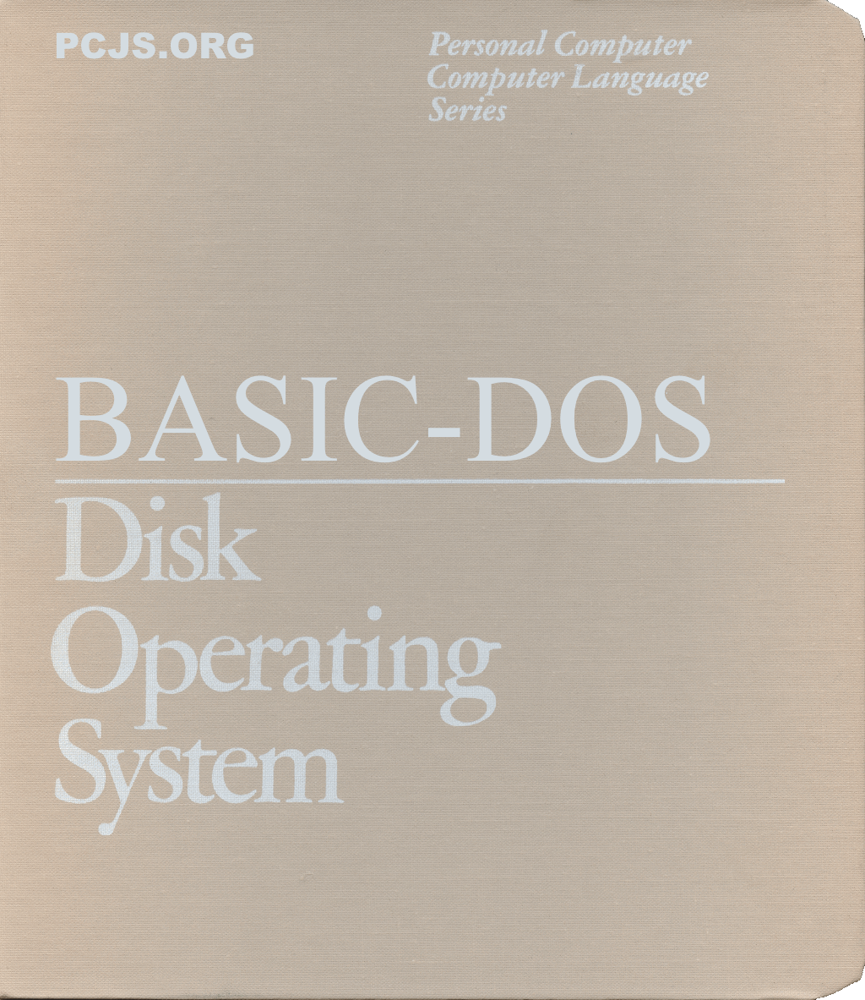

# PC DOS Reimagined

Read the [Blog](blog/), check out the [Preview](preview/), see a few of the original [Demos](demos/), and then [Download](#download) the current release.

## Download

The current BASIC-DOS release diskette is a bootable 360K diskette with BASIC-DOS, a "basic" set of utilities, and a few demo programs (including DONKEY.BAS, from PC DOS 1.00).  See it running on the [BASIC-DOS Release](download/) page, or download [BASICDOS-360K](software/disks/BASICDOS-360K.img), a diskette image that most PC emulators can boot, or which can be written to a genuine 360K diskette.

When we say that BASIC-DOS comes with a "basic" set of utilities, we mean that both figuratively and literally, because while some are written in assembly language, many are in fact written in BASIC, including [CHKDSK](docs/bdman/cmd/external/chkdsk/), [FORMAT](docs/bdman/cmd/external/format/), [MODE](docs/bdman/cmd/external/mode/), and more.  BASIC-DOS takes its commitment to BASIC integration, performance, and ease-of-use very seriously.

## Project Status

BASIC-DOS began as a technology demo: a reimagining of what the first IBM PC operating system *could* have been, with a unified DOS and BASIC command interpreter, preemptive multitasking sessions, and other features that PC DOS wouldn't offer for years (if ever).  The goal now is to turn it into a usable product.

It is not a goal to provide every PC DOS function, or to be 100% compatible with PC DOS.  BASIC-DOS implements what its own commands and BASIC programs need, plus enough of the PC DOS API to run typical DOS programs, so unchecked items below are possibilities, not commitments.

This section tracks what's been completed (**[x]**) and what remains (**[ ]**).  Items marked *partial* work, but with known gaps.

### Boot and System Configuration

- [x] Boot sector that loads the BASIC-DOS drivers, kernel, and interpreter
- [x] Boot message (removable with `SYS /N`); pressing certain keys within 2 seconds of the boot message can alter the boot process: **Esc** allows a floppy to boot from a hard disk instead, **P** selects protected-mode, **R** selects real-mode, and on a PC or PC XT running in PCjs, any letter makes BASIC-DOS prompt for the date and time instead of using the host's
- [x] Booting BASIC-DOS from a hard disk partition (eg, a disk built with `pc.js --sys=bd:2`), which becomes the default drive
- [x] CONFIG.SYS support for AUX, BUFFERS, CON, CPU, DEVICE, FILES, HOTKEY, MEMSIZE, PATHCHAR, PRN, RING, SESSIONS, SHELL, SKIP, and SWITCHAR
- [x] CON, AUX, and PRN are names for each session's console, AUX, and PRN devices rather than drivers: [CON=](docs/bdman/cfg/#con) defines the console (VKD$ or a serial port) of the next SHELL= line's session, which otherwise gets a full-screen VKD$ console, and [AUX=](docs/bdman/cfg/#aux) and [PRN=](docs/bdman/cfg/#prn) choose any device (COM1 and LPT1 by default); without one (eg, no LPT1), opening the name fails, and its handle stays reserved
- [x] SKIP= lists built-in drivers (by their exact device names, separated by commas) that should not be loaded (eg, `SKIP=VKD$,FPU$`); a skipped driver is never initialized, and its memory is reclaimed (CPU$, which manages memory, can't be skipped)
- [x] Installable device drivers (DEVICE=)
- [x] Critical ("hard") error handling: block device errors go to the session's INT 24h handler (called on a DOS stack, with PC DOS inputs and responses; in real mode, the stack is the second half of the interrupt vector table, so vectors 80h-FFh aren't available), and the default handler displays the traditional "Abort, Retry, Ignore, Fail?" prompt (see [Critical Errors](docs/bdtech/dos/#critical-errors))

### Device Drivers

- [x] VKD$ (video and keyboard), with a context for each console; when there's more than one, COMMAND.COM's banner on the console with focus adds "Press Shift-Tab to switch sessions" (or names the HOTKEY= key, eg, "Press Ctrl-T to switch sessions") (IOCTL_GETMODE with CL = 2 returns the number of VKD$ consoles and whether the caller's has focus); a mode change (eg, SCREEN) or an INT 10h call from a console without focus waits until it has focus
- [x] VKD$ text modes in place: a full-screen console changes between 40 and 80 columns on its own page, without clearing or pausing the display's other consoles, and the display's width follows the focus (an EGA or VGA BIOS sets the mode without clearing video memory; a CGA is programmed directly)
- [x] VKD$ virtual pages: consoles beyond an adapter's pages of video memory (eg, every console after the first full-screen one on an MDA) get pages of system memory, up to 8 pages per adapter, and switching focus to one exchanges its page with the page on the screen (see the [Multiple Pages demo](demos/p80/pc/) on an IBM PC with a Monochrome Display)
- [x] COM, LPT, NUL, CLOCK$, and PIPE$ devices
- [x] Several consoles on one serial terminal (ANSI or VT100): START on a COM console opens its new console on the same terminal, CTRL-\\ switches to the next one, and each console's screen is repainted from a copy that the COM driver keeps (if 64K of memory is free when the terminal's first console is opened; otherwise START fails there)
- [x] HOTKEY=^*char* sets one console-switching key for every console (the defaults are Shift-Tab on the keyboard and CTRL-\\ on a terminal)
- [x] CPU$, loaded first, detects the processor and manages all memory, with the same functions in either mode: using a table of physical memory blocks and protected-mode descriptors in protected mode, and otherwise an MCB chain (see [The CPU$ Drivers](docs/bdtech/mmu/#cpu))
- [x] CLOCK$ starts with the BIOS time of day and, on a PC AT, the real-time clock's date (or on a PC or PC XT running in PCjs, the host's date and time, which PCjs saves in vectors 58h-5Bh when it reads a BASIC-DOS boot sector), and converts between the tick count and the time exactly (to the hundredth, as MS-DOS does)
- [x] [DEBUG.COM](docs/bdman/cmd/external/debug/), which loads as a driver on a serial port (see the [demo](demos/debug/at/); with `/H`, it stops startup at its prompt, saying `Startup stopped by /H, G to continue`) or runs as a program (`DEBUG [program [arguments]]`), with an 80386 and 80387 disassembler, a SYMDEB-style assembler (A), single-stepping (T, TR, and P), 9 breakpoints plus a temporary one, exception traps and reports of software interrupt functions (VT; eg, disk reads and writes, and DOS file functions), SYMDEB-style memory dumps, memory and register editing, loading disk sectors (L, as a program), on an 80286, support for either mode (its prompt is the session number bracketed by `<` and `>` in real mode and `[` and `]` in protected mode, eg, `[1]`), and on an 80386, the 32-bit registers, FS, GS, CR0, CR2, and CR3
- [x] MOUSE$, a serial mouse driver (loaded only if a Microsoft-compatible mouse responds on a COM port at boot), with a minimal INT 33h interface (functions 00h-04h, 07h, 08h, and a BASIC-DOS function that returns queued button events), and a pointer drawn in MDA and CGA modes that preserves anything drawn over it
- [x] Serial consoles track the cursor's row as well as its column (so CSRLIN and LOCATE with an omitted row work on a terminal), and for VT100 terminals, COLOR selects reverse video, underline, bold, and blink, and the PC's line-drawing characters are translated to the VT100's special graphics set; LOCATE accepts row 25 on a 24-row terminal, where output is ignored, so that programs written for a 25-row screen (eg, TETRIS.BAS) still run
- [x] WIDTH 40 on a VT100 terminal, which has no 40-column mode: the COM driver makes each row double-width (ESC # 6) just before the row is first used, and again after a scroll or a clear
- [x] WIDTH 132 (and MODE 132) on a VT100 terminal: the COM driver asks the terminal whether it has the Advanced Video Option (AVO), so a VT100 without it gets the 14 rows it can display in 132 columns instead of 24; VI.COM, MORE, HELP, and DIR /W use whatever the console has, and the focus can move between consoles with different widths on one terminal
- [x] A VT100 console starts with a clear screen (80 columns, no attributes, and every row scrolling), instead of whatever the terminal was displaying before the system was started
- [x] The demos' VT100 terminals have the AVO (bold, blink, underline, and 132 columns by 24 rows), with [no-AVO versions](demos/vt100/xt/noavo/) of the VT100 Terminal demo pages for comparison
- [x] Scrolling rows for both console drivers (IOCTL_SCROLL can set the rows that scroll, which a VT100 does with its scrolling region), used by VIEW PRINT and VI.COM (which scrolls only its text rows, and only the rows below a line that's inserted, deleted, or joined, instead of redrawing them), and erase to the end of a row (IOCTL_SETPOS), which VI.COM uses when a row gets shorter; VI.COM also keeps a copy of each row on the screen, so it writes only the part of a row that changed (eg, one character per key typed at the end of a line) and moves the cursor only when it isn't already in place
- [x] Interrupt-driven, asynchronous I/O for VKD$ and COM (COM ports also report how many bytes are waiting, with IOCTL_INSTATUS, for BASIC's EOF, LOC, and INPUT$)
- [x] Non-ASCII keys (eg, cursor and function keys) are returned as a zero followed by the key's scan code, as in PC DOS (for VKD$, and for VT100 terminals on COM ports), so INKEY$ sees them as BASICA programs expect (eg, F10 in COMM.BAS); the DOS line editor maps the keys it uses to its editing keys, and raw keys mode only turns hotkeys like CTRL-C into ordinary keys
- [x] Floppy disk reads, including multi-track requests and requests that cross 64K boundaries
- [x] Floppy disk writes
- [x] Media check and BPB rebuilds (reads PC DOS 1.x and 2.x diskettes)
- [x] *partial*: Hard disk reads and writes (HDC$), for the FAT12 and FAT16 primary partitions of up to two PC XT or PC AT hard disks, which become drives C:, D:, etc. (drives A: and B: are always reserved for diskettes); a disk with no FAT partitions (eg, a new disk) is still given a drive letter (with "unknown media"), and IOCTLs return its geometry and partition table (IOCTL_GETPART) and write a new MBR with the driver's own boot code (IOCTL_SETPART), so that FORMAT can partition it
- [x] Diskette formatting: IOCTL_SETPARMS gives a volume its BPB (so that an unformatted diskette can be written) and IOCTL_FORMAT formats and verifies a track, with the DPT's sectors per track set from the BPB (for every diskette transfer, so 8-sector diskettes read correctly, too); see FORMAT.BAS under [Utilities](#utilities)

### Protected Mode

On an 80286 or later with sufficient memory (256K or more), BASIC-DOS runs in protected mode by default, unless `CPU=8088` is present in CONFIG.SYS (or you press **R** immediately after the "System starting" message), which selects real mode, the most compatible mode (eg, for MZ EXE files).  All BASIC-DOS components are designed to run in either mode.  See [Protected Mode](docs/bdtech/mmu/) for details, and try any PC AT or DeskPro 386 [demo](demos/) (eg, the [Extended Memory demo](demos/mmu/)).

- [x] On an 80286 or later (unless CONFIG.SYS has `CPU=8088`), BASIC-DOS switches to protected mode while its drivers initialize, and stays there, given at least 256K of conventional memory (any extended memory is a bonus; the 640K PC AT demos have none); otherwise, it runs in real mode, as on an 8088
- [x] COMMAND.COM, BASIC programs, and every program they run at ring 3 (unless CONFIG.SYS has `RING=0`), with each console's sessions' memory in an LDT of their own (a session that a program starts, eg, for a pipeline, shares the program's), so a program can't write to memory that isn't its console's
- [x] A ring 3 program's CTRL-C, critical error, and interrupt handlers run at ring 3, too (interrupt handlers see only the interrupts that ring 3 code in its session issues)
- [x] A ring 3 program can free or resize only its own memory blocks, whose selectors always fit their lengths, and a bad pointer, stack, or return address ends the program, rather than stopping the system
- [x] The PMB table and each LDT (up to 256 descriptors) grow as needed, sharing about 36K of the system area, and CPU$ keeps interrupts on while it works on them
- [x] A ring 3 program can issue only DOS's, the mouse's, and the user interrupts (not the BIOS's), and it can't reach another LDT's descriptors through the GDT, or another session's files through a forged handle
- [x] A ring 3 program can hook only the exception vectors it can handle, INT 21h, and INT 60h-67h, and can't change the kernel's record of its parent, stack, or handlers by writing its PSP
- [x] At ring 3, every copy of COMMAND.COM runs one copy of its code, which none of them can write and which is freed with the last copy, so each additional session needs only a few K, as in real mode
- [x] COM and NE programs (eg, PRIMES.EXE) run in protected mode
- [x] NE libraries: an NE program can import functions by ordinal from libraries (`X.DLL` for module X, in the system drive's **EXT\\DLL** directory, or the one that a `LIBPATH=` line in CONFIG.SYS names), which the loader loads with it; DOSCALLS.DLL (built in `software/src/os/dll`) provides OS/2's DOSCALLS functions as DOS calls: the 22 that LINK386 imports (files, segments, program exit and execution, CTRL-C signals, and system information) and the three that search directories (DosFindFirst, DosFindNext, and DosFindClose); see DLLTESTS.EXE in **TESTS\\REGRESS**
- [x] OS/2 1.x programs: an NE file marked as an OS/2 program starts with OS/2's registers (its data segment, environment, and command line), which DOSCALLS.DLL sets up, so LINK386 (in **TOOLS\\BIN**, unmodified) runs in protected mode, with KBDCALLS.DLL, MSG.DLL, and NLS.DLL providing the three other functions it imports; it links 32-bit LE programs to the same files that it does on MS-DOS, so a 32-bit program can be built entirely on BASIC-DOS: `MAKE MAKEFILE` in **SRC\\SDK** on the hard disk assembles and links MEM32.EXE (MASM5, then LINK386), which then runs on an 80386
- [x] OS/2 programs built on BASIC-DOS: **SRC\\SDK**'s FIND16.EXE is FIND.COM written for OS/2 1.x (it calls only DOSCALLS functions, with the PCALL macro in **SRC\\INC**'s os2.inc), built by MASM5 and LINK4; the same file runs on OS/2 1.0 and, in protected mode, on BASIC-DOS, since a file that names no operating system and isn't marked PROTMODE (like OS/2 1.0's own programs) starts as an OS/2 program
- [ ] LINK386 in real mode, where its own DOS loader can't find the program ("SYS2090"), since BASIC-DOS doesn't give a program its path
- [x] MASM 4.00, MASM 5.10B, MAKE 4.02, LINK 3.05, LINK4 5.00.12, EXEMOD 4.00, MAPSYM 4.00, and EXE2BIN in **TOOLS\\BIN** on the hard disk are converted from MZ to NE executables, about the size of the originals, that run at ring 3 in protected mode and through an NE loader stub in real mode
- [x] Microsoft C 4.00 (CL, C1, C2, and C3) in **TOOLS\\BIN** on the hard disk is converted the same way, with its include files in **TOOLS\\INCLUDE** and its libraries in **TOOLS\\LIB**, where BASIC-DOS versions of the C libraries (a new startup module) and the alternate math libraries (floating point by way of the FPU$ driver) build NE programs that run at ring 3; compile with `/FPa`, link with LINK4, and run STUB (a C program itself, with its source in **TOOLS\\STUB**) to add the NE loader stub, so that the program runs in real mode, too (see the [tools README](https://github.com/jeffpar/basicdos/blob/main/software/src/tools/README.md), and the sample in **TOOLS\\DEMOS\\HELLO**)
- [x] BDC.EXE, a small single-pass C compiler written for BASIC-DOS (in **TOOLS\\BIN**, with its source in **TOOLS\\BDC**), whose object files link with Microsoft C's libraries and object files; it compiles several times faster than Microsoft C 4.00 (but its code is larger and slower), accepts prototype-style function definitions and `//` comments, and compiles itself (see the [tools README](https://github.com/jeffpar/basicdos/blob/main/software/src/tools/README.md#bdc), and `MAKE BDC` in **TOOLS\\DEMOS\\SUCKS**)
- [ ] BDC: floating point, bit fields, structures as arguments and return values, and other memory models
- [x] The NE loader stub (`mkne.js --stub`) replaces an NE program's MZ stub, so its one NE image also runs in real mode, without a second copy of the program: on BASIC-DOS, and if the program uses only DOS functions, on PC DOS 2.00 and MS-DOS 3.20
- [x] BASIC-DOS can build itself with these tools, in real mode or at ring 3 in protected mode, with the same binaries as an MS-DOS build
- [x] Exceptions: a fault in a program's own code ends that program with `CPU fault nn (EC=nnnn) at nnnn:nnnn` (ERRORLEVEL 255), as a divide error does; anywhere else, CPU$ prints the same line and `System halted`, and stops the machine, unless DEBUG.COM is loaded as a driver and takes over (see [Faults](docs/bdtech/mmu/#faults))
- [x] DEBUG.COM as a driver can stop and resume ring 3 programs with all of its commands, and can display the GDT, the IDT, and any session's LDT (DG, DI, and DL), and the running session's V86 machine's memory (as `&` addresses), and a CTRL-C that interrupts a V86 machine stops in the machine (with its registers, a prompt in parentheses, and T, P, and breakpoints there); as a program, it runs at ring 3 with fewer commands, and in a V86 machine, DM displays the machine's memory blocks
- [x] A ring 3 program draws directly through an LDT selector for its console's video memory, which VKD$ manages (the identity selectors for video memory are only for ring 0): while another console on the same adapter is in another mode, the selector maps the saved copy of the console's video memory (see below), or if there's no copy, it isn't present, and a program that uses it waits, as the console's output does; a driver can remap or remove such a selector in any LDT (CPU_MAP with MEMF_REMAP)
- [ ] Ring 3 for the programs that still need `RING=0`: those that hook an interrupt issued by ring 0 code (eg, INT 1Ch or INT 13h), call CPU$ (eg, CPUTESTS), or use IN, OUT, CLI, or STI
- [ ] MZ EXE files in protected mode, which fail with "Unable to load" (and on an 80386, "Run START V86 first", since a V86 machine runs them; currently NOT under consideration for inclusion in BASIC-DOS, since NE programs take their place; see [Limitations](docs/bdtech/mmu/#limits))
- [x] VKD$ saving blocked consoles' video memory: before a console takes the entire screen with a mode change (eg, SCREEN 1), the adapter's video memory is copied to a buffer, which the other consoles on the adapter use (and their video memory selectors map) until it's copied back, so their output and programs keep running and their screens come back afterward; switching the focus to one of them hides the console that has the screen instead (its video memory is saved, too, and restored with its mode when the focus returns), so a program in a graphics mode can always be left, or ended from another console
- [ ] DEF SEG's video memory selectors through VKD$, so that a POKE to video memory goes to the console's own video memory (eg, its saved copy)
- [x] CPU$ uses the 80386's features on an 80386 (unless CONFIG.SYS has `CPU=80286`): an 80386 TSS, selectors that can cover more than 64K (CPU_SETLIM), and paging, which maps physical memory at C0000000h, leaving the lower linear addresses free (see the [DeskPro 386 Extended Memory demo](demos/mmu/386/))
- [x] V86 machines on an 80386 (CPU_V86, through DOS_UTL_MAPSEG): real-mode code runs in virtual-8086 mode at ring 3, with CPU$ emulating CLI, STI, PUSHF, POPF, INT, and IRET, and V86.COM runs real-mode COM programs that use DOS functions in one, with 640K of memory or the size that `/M:size` gives it, in K (and when V86 has a session of its own, eg, START V86, a failure waits for a key before its console closes)
- [x] V86.COM runs COMMAND.COM (the default, so `START V86` opens a real-mode command shell) and the programs it runs in a V86 machine: COM and MZ EXE files (eg, MASM, SYMDEB, and DEBUG, whose CPU$ calls V86.COM answers), memory blocks, EXEC, BASIC-DOS's own functions, floating-point (through a copy of FPU$ in the machine), pipes (whose later programs run in protected mode), and CTRL-C
- [x] V86.COM: the common BIOS video, keyboard, and printer functions (INT 10h, 16h, and 17h), translated to console driver and DOS functions, so that real-mode programs that use them run (eg, MSBASIC)
- [x] V86.COM: timer ticks for the machine (INT 08h and 1Ch, and the BIOS tick count), and I/O ports, through a table of handlers in V86.COM; a machine never uses a port itself (CPU$ answers the interrupt controller's and the game port's without an exit)
- [x] V86.COM: the console's video memory, at its usual address (eg, a text console's own page at B8000h, as page 0 would be, whatever page it's on), so that COMMAND.COM's graphics statements (eg, in DONKEY.BAS) and programs that draw directly work in a V86 machine on a video console; while another console on the same adapter is in another mode, the machine's pages are the saved copy of that memory, so it keeps running, as a protected-mode program does
- [x] V86.COM: an EGA or VGA's graphics modes (0Dh-13h) on a video console, with the 64K at A0000h and the video ports (3C0h-3DFh) open to the machine through the 80386 TSS's I/O permission bitmap; keyboard interrupts (INT 09h, with scan codes from VKD$ at port 60h), the timer's rate (ports 40h-43h), INT 11h, 12h, and 1Ah, and ports with no device behind them, so that Wolfenstein 3D runs in `V86`
- [x] SND$, a Sound Blaster driver (loaded only on an 80386 with a card at 220h or 240h) that lends the card to one V86 machine at a time: CPU$ lends the machine the card's ports and its FM synthesizer's (CPU_V86 with AL = 4 and 5, through the TSS's I/O permission bitmap), SND$ counts its interrupts for the machine and keeps a virtual DMA controller for it (translating its addresses to physical ones, so a machine's memory starts on a 64K boundary), V86.COM chains the machine's interrupt handlers on its stack (so 700 ticks a second need no exits), and the card is reset and given back when V86 ends, even if it's killed, so Wolfenstein 3D's music and digitized sound work in `V86`
- [x] Switching away from a V86 machine in a VGA graphics mode (eg, Wolfenstein 3D): VKD$ saves the adapter's state (INT 10h function 1Ch, plus all four planes) and CPU$ suspends the machine (no instructions run until its video memory selector is present again), SND$ pauses its Sound Blaster, and switching back restores everything and resumes it
- [x] Faster V86 machines: CPU$ emulates CLI, STI, PUSHF, POPF, INT, and IRET without leaving the machine's context (its IDT, page directory, and ports), checks each interrupt frame on its stack once, and finds a machine's memory block without a search, so Wolfenstein 3D reaches "Press a key" in about 5 seconds instead of 15-20 (real mode takes about 2.5)
- [ ] V86.COM: the rest of the BIOS, for real-mode programs that use it
- [x] 32-bit LE programs on an 80386 in protected mode (built with MASM 5.10B and LINK386 from the Windows 3.1 DDK, in **TOOLS\\BIN**, with their segments in a group named FLAT): the kernel loads one into a *flat machine* (CPU_V86), where its code runs at ring 3 in a linear address space of its own (its memory starts at 10000h, initially up to 256K, and DOS_MEM_ALLOC adds more), with its own page tables and the V86 machines' 80386 interrupt gates, so the system's 16-bit gates and every 16-bit program work as before; its INT 21h calls are made for it by 16-bit kernel code at ring 3, with selectors for its 32-bit pointers (see [Flat Machines and LE Programs](docs/bdtech/mmu/#flat))
- [x] Debugging LE programs with DEBUG.COM's driver: an INT 3 (eg, a DBGBRK or ASSERT from the system's macros, which **SRC\\SDK**'s MEM32 includes), a breakpoint, a CTRL-C, or a fault that VT traps stops in the 32-bit code, with 32-bit registers (R), disassembly (U), and assembly (A), linear addresses (eg, `D ESP+8` or `D ES:80`), and T, P, BP, G, and GT
- [ ] LE programs: the rest of the DOS functions (FCBs, the DTA, vectors, and EXEC), freeing memory, and in DEBUG.COM, loading an LE program (`DEBUG program`)

### Kernel: Processes, Memory, and Sessions

- [x] COM and EXE program loading, PSPs, EXEC, and exit codes
- [x] Memory allocation (through CPU$, which uses MCBs on an 8088), from all of memory (on an 80286 in protected mode, conventional and extended memory alike, plus a COMPAQ 80386 machine's built-in memory below 16Mb, and MEM and FRE count all of it), including per-program heap requests, and allocation from the top of memory (MCBTYPE_HIGH), which the interpreter uses for its own blocks so that the memory below them stays contiguous
- [x] DOS_UTL_QRYMEM queries any memory block (its size in bytes, since a block can be 1Mb or more)
- [x] DOS_UTL_QRYSCB with CL = -1 returns SYSINFO, facts about the system that programs at any ring can use (total memory, the BUFFERS, FILES, and SESSIONS counts, the CPU type and flags, the HOTKEY= key, and the total references to open files), so that no program reads DOS's tables, the BIOS data area, or CPU$ for them, and DOS function 52h returns only ES:BX and DX
- [x] INT 2Bh utility functions numbered contiguously (00h-28h) and grouped by purpose (see the [Technical Reference](docs/bdtech/util/))
- [x] START [/B] *program* [*arguments*] runs a program in a new session, on a new full-screen console (eg, `START COMMAND` for another shell, which can EXIT, closing its console), which gets the focus (and gives it back to the console that had it when it closes) unless `/B` (background) comes before the program (eg, `START /B V86 /M:256 DEBUG`), with an LDT of its own in protected mode; consoles' pages are reused once their consoles close; a new COMMAND (or V86) gets the caller's PATH$; START alone lists each session's number, memory in use, and program
- [x] Preemptive multitasking of multiple sessions, where each write to a device that sessions share (eg, a console) is whole, so their output doesn't interleave within a write; a session closes when its last program ends (eg, KILL from another session), and the system halts when no session is left, but the shell that CONFIG.SYS starts in each session ignores EXIT (as PC DOS's COMMAND /P does) and survives KILL; without SESSIONS=, there's a session for each console, plus 4 for pipeline filters if PIPE$ is loaded, plus 4 more with more than 256K of memory; MEM /A displays the number of buffers, files, and sessions
- [x] CTRL-C/CTRL-Break handling, CTRL-ALT-DEL session aborts, and divide and overflow errors, which end the program (as MS-DOS does) without aborting its parent, unless the program asks for them as signals to its CTRL-C handler (as COMMAND.COM does, for BASIC's floating-point errors; see [Exception Signals](docs/bdtech/dos/#exception-signals)) (vectors 00h, 01h, 03h, 04h, 08h, 09h, 1Bh, and 1Ch that a terminated program left hooked, like MSBASIC's, are restored)
- [x] Session END: abort the current program in a specified session, interrupting any pending wait; WAITEND waits for the session to close
- [x] Environment segments for EXEC (EPB_ENVSEG; zero inherits the parent's), and COMMAND.COM gives every program an environment with COMSPEC and PATH
- [ ] TSR support (INT 27h and INT 21h function 31h; currently NOT under consideration for inclusion in BASIC-DOS)

### Kernel: File System

- [x] FAT12 and FAT16 file systems with read/write support
- [x] Handle-based open, read, seek, IOCTL, and close
- [x] Find first/next, disk info (free space), and current drive/DTA
- [x] Handle-based file creation (function 3Ch) and writing (function 40h)
- [x] File deletion (function 41h) and renaming (function 56h)
- [x] FAT cluster allocation and freeing
- [x] Write-back of modified FAT and directory buffers (every FAT copy is updated), including when the buffer is reused, on file close, disk reset, and restart
- [x] FCB support: open, create, close, sequential, random, and random block reads and writes, find first/next, delete and rename (with wildcards), file size, set relative record, and filename parsing (functions 0Fh-17h, 21h-24h, and 27h-29h), including extended FCBs and device names
- [x] Truncating/extending a file with a zero-length write (function 40h, and FCB function 28h)
- [x] Subdirectories: paths (separated by `\`, or `/` when PATHCHAR is `/`) in all file functions, MKDIR and RMDIR (functions 39h and 3Ah), subdirectories that grow as needed, and per-session current directories for every drive (CHDIR and GETCWD, functions 3Bh and 47h; GETCWD saves the last path it built, so prompts don't reread the disk)
- [x] Same-drive file and directory moves (function 56h): preserve contents and metadata, update a moved directory's `..` entry, retain active current directories, and reject moves into itself or a descendant
- [x] Absolute disk reads and writes: opening a volume (eg, `C:`) as a file gives read/write access to its sectors, in place of INT 25h and INT 26h; a volume can also be created (ie, opened FOR OUTPUT) and opened when its media is unknown (eg, an unformatted diskette), with no critical error prompt, and IOCTLs on a volume handle go to the drive's driver (with their errors returned to the caller)
- [x] Configurable open file limit (FILES=8-254, default 20, or 8 with 128K of memory or less)
- [x] Configurable disk buffer cache (BUFFERS=2-32, default 8, or 3 with 128K or less), with least-recently-used replacement for FAT sectors, directory sectors, and file reads of less than a sector; other file data is transferred directly by the disk drivers, with one request for each run of clusters that are next to each other on disk (a write allocates all the clusters it needs first, as in PC DOS)
- [x] File attributes: a read-only file can't be opened for writing, replaced, or deleted; getting and setting a file's attributes (function 43h) and a handle's time and date (function 57h, kept when the file is closed); and on every BASIC-DOS disk, BASDEV.COM and BASDOS.COM are read-only hidden system files and COMMAND.COM is a read-only system file; BASIC's OPEN FOR RANDOM opens a read-only file for reading (as MSBASIC does)
- [ ] Extended disk partitions (currently NOT under consideration for inclusion in BASIC-DOS)

### Command Interpreter: DOS Commands

- [x] CD, COPY, DATE, DEL, DIR, EXIT, KILL, MD, MEM, RD, TIME, TYPE, and VER (HELP is an external command; see [Utilities](#utilities))
- [x] On a machine with no real-time clock (eg, an IBM PC or PC XT), the first SHELL prompts for the date and time before its startup commands, as PC DOS does at boot, unless COMMAND.COM's `/Q` comes first or PCjs supplied the date and time
- [x] KILL ends a session (a number that START lists; in a CONFIG.SYS session, only its shell's programs), and KILL /A restarts the system (with a warm boot, after asking)
- [x] DIR listings begin with the volume label and the directory's full path, as in DOS 2.x, but without its leading blank line and indentation (FFIRST with attribute 08h finds only the volume label, and GETCWD with DL = FFh returns the path of the directory FFIRST searched), and an empty root directory is listed like an empty subdirectory, with `0 files`, instead of as an error
- [x] DIR /A lists hidden files (only the hidden attribute keeps a file out of DIR, so system files like COMMAND.COM are listed), DIR /S lists the matching files in every subdirectory, with a header and totals for each directory, and DIR /W lists only the names (eg, HELP.TXT, with the path character after each directory), in as many 16-character columns as the console has room for
- [x] The prompt displays the current drive and directory (eg, `<C:\SUBDIR>`), bracketed by `<` and `>` in real mode, `[` and `]` in protected mode, or `(` and `)` in V86 mode, and switches use `/` (eg, `TIME /P`), as in PC DOS, unless SWITCHAR is `-` or PATHCHAR is `/`, in which case they use `-`
- [x] Running COM, EXE, BAT, and BAS files, and loading programs into other sessions
- [x] BAT and BAS files can run other BAT and BAS files and then continue (no CALL command required); a nested BAS file gets its own variables
- [x] Pipes (`|`) and output redirection (`>` creates or truncates the output file, `>>` appends to it), including redirection at the end of a pipeline (eg, `DIR | SORT > TEST`)
- [x] Input redirection (`<`) for the first command on a line, after its arguments and before any `|` or `>` (eg, `SORT /R < NAMES.TXT > SORTED.TXT` or `SORT < NAMES.TXT | MORE`)
- [x] `:>` and `:>>` redirect the output of an entire line, including BASIC statements, where `>` means "greater than" (eg, `PRINT "hello world" :> TEST`), at the prompt and in BAT and BAS files
- [x] At the prompt, a line of BASIC statements can end with a pipe (eg, `FOR I=1 TO 100:PRINT 3.14^I:NEXT | MORE`); the statements run once the rest of the pipeline has started, and a runtime error still ends the pipeline's input
- [ ] Pipes after BASIC statements in BAT and BAS files (currently only at the prompt)
- [x] A BAT or BAS file can be the first command of a pipeline (eg, `LS | MORE`): like a built-in command, it runs once the rest of the pipeline has started, so it can't fill the pipe before anything reads it, and its ARG$ ends at the `|`; a deferred command that fails (eg, `TYPE NOFILE | SORT`) sets ERRORLEVEL to 1.  A BAT or BAS file can't come after a `|` (it would have to run in the first command's session), so that's an error (eg, `DIR | TEST.BAS` reports "Unable to open TEST.BAS")
- [x] COPY creates (or truncates) the output file, and refuses to copy a file onto itself
- [x] COPY and TYPE read through a temporary block of up to 32K (or half of the largest free block, if that's smaller), so that copying a file doesn't take several disk transfers per sector
- [x] A DOS command (internal or external) ends at a colon that begins a word, so other commands can follow it on the same line (eg, `DIR *.BAS : PRINT "done"`), at the prompt and in BAT and BAS files; a colon after a drive letter, or a switch of any length (eg, `/ALIGN:16`), is part of the command
- [x] A command that fails (internal or external, eg, "Unable to find" or "Unable to open") displays its message and sets ERRORLEVEL to 1, and a BAT or BAS file continues with its next command, as in PC DOS; a successful command sets ERRORLEVEL to 0, and a program's non-zero exit code isn't a failure (see [Error Handling](docs/bdman/lang/#error-handling))
- [x] Any DOS command that accepts a file name (eg, COPY, DEL, DIR, LOAD, SAVE, TYPE, CD, MD, RD), and any redirection (`<`, `>`, `>>`, or `:>`), also accepts a string variable whose value is the file name (eg, `DIR D$`, `COPY CON NAME$`, or `DIR > F$`), and quoted file names (eg, `TYPE "TEST$"`); expressions aren't evaluated, so DEL reports a syntax error for anything after the file name (eg, `DEL "TEMP" + N$`); see [Command Arguments](docs/bdman/lang/#command-arguments) for how BASIC statements and external commands differ
- [x] External commands receive the values of string variables in their arguments (eg, `FORMAT D$` or `FIND S$ *.TXT`), quoted if they contain spaces
- [x] ECHO ON/OFF and the `@` prefix in BAT files: every BAT file starts with ECHO ON, as in PC DOS (so most begin with `@ECHO OFF`), echoed lines are displayed with a `@` in front, and a leading `@` is ignored at the prompt, too
- [x] A BAS file run from the command prompt remains loaded when it ends, along with its variables (like MSBASIC), so it can be LIST'ed or RUN again; RUN reuses the program's compiled code once it has all been compiled (even if CTRL-C stopped the last run), unless the program or its variables have changed since, so it starts immediately
- [x] Resident and transient portions: before running a COM or EXE file, COMMAND.COM frees idle variable blocks and discards its transient portion (about 45K), restoring it when the program ends (from a copy at the top of free memory, if the program didn't overwrite it, or else from COMMAND.COM); MEM includes the transient portion in its bytes available, and MEM /A displays the smaller bytes for BASIC separately (which is all that the programs of a pipeline have); a program that there isn't enough memory to load is reported as "Not enough memory", after COMMAND.COM (at the prompt) frees all variables, arrays, and user-defined functions (much as CLEAR does) and tries again
- [x] Filters: FIND (/C, /I, /N, /R, /V), MORE, SED (/I, /N), SORT (/R, /+n), TEE (/A), TR (/C, /D, /S), UNIQ (/C, /D, /I, /U), and WC (/B, /L, /W, /C); FIND, MORE, SED, SORT, UNIQ, and WC also accept file names, FIND's string and SED's script need quotes only if they contain spaces, and every filter treats CTRL-Z as the end of input
- [x] Regular expressions in the style of UNIX `ed` and `sed` (`.`, `[...]`, `[^...]`, `*`, `^`, `$`, `\(...\)`), shared by FIND /R and SED, whose scripts have line-number, `$`, and `/regex/` addresses (and ranges and `!`) and the s (with `&`, `\1`-`\9`, `\n` for a line break, g, and p), d, p, q, and = commands
- [x] Pipelines with more than one filter (eg, `TYPE FILE | SORT | MORE`): when a session ends, its output pipe receives end-of-input
- [x] Pipe reads return as soon as some data is available (like UNIX pipes), so a filter such as MORE displays a pipeline's output as it's produced, instead of a buffer at a time
- [x] When any command of a pipeline fails (eg, a program that can't be found, or no session available for it), the error is reported, the commands already running in other sessions are ended (DOS_UTL_END), and the first command never runs; and when a command stops reading a pipe early, the command writing to it gets a write error instead of waiting forever
- [x] LIST VARS: list preserved strings (including PATH$), scalar values, and array dimensions in the current session
- [x] PATH$: the directories searched for programs (eg, `PATH$="A:\;A:\EXT\CMD;A:\EXT\BAS;A:\DEMOS"` on a SHELL line in CONFIG.SYS); unlike other variables, it survives NEW and CLEAR
- [x] PROMPT$: a custom prompt, as a PRINTF format whose specifiers supply their own values (eg, `PROMPT$ = "%.3W %H:%02N %s%g"` for `Tue 14:05 A:\>`): the current directory (`%s`), the mode's `>`, `]`, or `)` (`%g`) and its left counterpart (`%l`), the session number (`%d`), a new line (`%n`), and the date and time letters; it survives NEW and CLEAR, too
- [x] Command history: Up and Down at the prompt display older and newer commands, or only those that begin with the characters typed first (eg, `DIR` and Up for the latest DIR command), from each session's history of the latest commands that fit in 1K, which HISTORY$(*n*) also returns; the DOS line editor (DOS_UTL_EDITLN) returns Up and Down to COMMAND.COM, so the kernel keeps no history
- [x] Every bootable BASIC-DOS disk has the same layout: BASDEV.COM, BASDOS.COM, COMMAND.COM, CONFIG.SYS, and AUTOEXEC.BAT (if any) in the root, utilities in EXT (assembly language programs, including DEBUG.COM, and HELP.COM with HELP.TXT, in EXT\\CMD, BASIC programs, such as FORMAT.BAS and LS.BAS, in EXT\\BAS, and libraries in EXT\\DLL), and demo programs in DEMOS, including BROGUE.BAS and DONKEY.BAS, the only PC DOS 1.00 BASIC sample on every disk (test programs are on a separate diskette, in TESTS, and the rest of the samples are only on the 10Mb hard disk, in TESTS\SAMPLES); the [BASIC-DOS Release](download/) diskette, BASICDOS-360K (which leaves out the TESTS folder that a few demo diskettes have for tests their pages can run, eg, PIPES.BAT on the Dual Monitor diskettes and FPUTESTS.COM on the Single diskette; their CONFIG.SYS files add it to PATH$), is also available as a raw 360K image; every disk has a volume label (eg, BD-D40), and every machine's diskette list shows the BASIC-DOS diskettes by title (eg, "BASIC-DOS 40-Cols"); the 10Mb hard disk's directories are in the same order as a diskette's (EXT and DEMOS, followed by SRC, TESTS, and TOOLS), since pc.js's `--order` option overrides its usual sorting
- [x] REN: rename files and directories and move them between directories on the same drive
- [x] Loading tokenized (binary) BAS files saved by BASICA or GW-BASIC (eg, the samples on the PC DOS diskettes): they're converted back to text as they're loaded (as LIST would display them), including MBF floating-point constants (converted to IEEE doubles and formatted by FPU$); protected BAS files are still rejected with "Invalid file format"
- [x] Disk utilities are external programs; see [Utilities](#utilities)

### Utilities

Utilities live in the EXT directory of every BASIC-DOS disk: assembly language programs in EXT\\CMD, and BASIC programs in EXT\\BAS.  The filters, HELP, SLEEP, VI, and DEBUG are assembly language, but utilities that don't need that speed are written in BASIC-DOS BASIC: clean, succinctly commented programs, with every line indented by a tab (after a line number only where one is needed as a label), the style in which BASIC-DOS lists programs.  The interpreter is extended as needed to make them possible (eg, IOCTL #, and opening unformatted volumes, for FORMAT).

- [x] *partial*: FORMAT.BAS (360K diskettes by default, /1 for single-sided, /8 for 8 sectors per track, and /S to copy the system files from the system drive), which formats and verifies each track through the diskette driver, builds the boot sector, FATs, and root directory using the PC DOS 2.x rules for cluster and root directory sizes (with 12-bit FATs, which PC DOS 2.x used whenever it could), and reports the space available; it refuses the current drive and the system drive
- [x] *partial*: FORMAT for hard disks: it displays the disk's partition table first, formats one of its FAT volumes (asking which, when the drive given is the whole disk) after a warning, and when a disk has no partition table, offers to create one (with prompts, rather than a separate FDISK) with a single volume of the size requested in Mb (up to 32Mb), writing an MBR and formatting the volume (12-bit FAT up to 32680 sectors, as PC DOS 3.x did, and 16-bit FAT beyond)
- [x] FORMAT.BAS: 720K and 1.2M diskettes (/F:720 and /F:1200, or by default, the drive's own size, which the diskette driver's IOCTL_GETPART reports on a PC AT), with PC DOS 3.x's layout for 1.2M, and volume labels (/V or /V:*label*); since a colon in a DOS command can now follow a switch's letter, switch values like /F:720 work in BAS and BAT files, too
- [x] CHKDSK.BAS (checks every cluster chain, and reports cross-linked files, allocation errors, invalid clusters, lost clusters, and disk space, without fixing anything), COMP.BAS, DISKCOPY.BAS (formats the target as it copies, with multiple passes for single-drive copies), HEXDUMP.BAS (DEBUG's DB format, with /S and /N), LABEL.BAS and VOL.BAS (writing the label entry directly), SYS.BAS, and TREE.BAS (with /F and /A)
- [x] ATTRIB.BAS: displays the attributes (R, H, S, and A) of the matching files, including hidden and system files, after setting (+) or clearing (-) any that are given (eg, ATTRIB +R *.BAS), using the DOS statement
- [x] LS.BAS: a UNIX-style `ls`, listing files and directories sorted, in 16-character columns down the console, aligned with DIR /W's (or one per line when the output is a file or pipe), with a path character after each directory name, and /1, /a, /l, /R, /r, /S, and /t, which can be combined (eg, `LS /ltr`)
- [x] Utilities report what they can't handle: COMP compares any number of matching files (it used to stop silently after 201), TREE and LS display `Too many subdirectories` and `Too many matching files`, CHKDSK names any directories it doesn't check and doesn't report lost clusters in that case, and FIND, WC, and other filters reject more than 8 file names with `Syntax error`; COMP also sets ERRORLEVEL to 1 if any comparison fails, and CHKDSK if it finds problems or can't check everything
- [x] Consistent BAS utility arguments: switches start with the switch character (eg, `-` after SWITCHAR=-), and a missing or invalid argument, such as an unknown switch (which CHKDSK, FORMAT, and TREE used to ignore), displays `Syntax error`
- [x] Every command rejects switches it doesn't accept with `Syntax error`, in any position (internal commands from COMMAND's table of switches, and assembly utilities from their own lists), so that a mistyped switch (or path, eg, `CD ../..`) can't silently change what a command does; usage text lives only in HELP.TXT, which HELP displays as `Usage:`, a blank line, and the rest of the entry
- [x] An internal command after a pipe (eg, `VER | DIR`), which used to hang, displays `Syntax error`, since internal commands don't read their input
- [x] END *n* sets ERRORLEVEL (0 if *n* is omitted), and the BAS utilities use it to report failures
- [x] Switches can appear anywhere on a command line (including VI's `/WS`, and COPY's `/B`, which is accepted for compatibility with PC DOS and does nothing, since COPY always copies and concatenates entire files)
- [x] MODE.BAS: display columns and color (MODE 40, 80, BW40, BW80, CO40, CO80, which always clear the display with the default colors, even if the mode is unchanged) and rows (eg, MODE CO80,43 on an EGA or VGA, or MODE CO80,50 on a VGA, which WIDTH 80,43 and WIDTH 80,50 do in BASIC, using the adapter's 8x8 font), serial ports (eg, MODE COM1:9600,N,8,1, which sets the port by opening it with those parameters and no input buffer), and printer columns and lines per inch (MODE LPT1:132,8)
- [x] HELP.COM: HELP is an external command, which reads HELP.TXT from the EXT\\CMD directory of the drive COMMAND.COM was loaded from (normally the boot drive), so that COMMAND.COM's core is 963 bytes smaller and low memory systems have more room for BASIC programs; KEYS is now `HELP KEYS`
- [x] [VI.COM](docs/bdman/cmd/external/vi/): a full-screen text editor with a subset of the commands of the UNIX *vi* editor (and WordStar keys with /WS), for VKD$ consoles and ANSI or VT100 serial consoles, and files of up to 64K
- [ ] Additional FORMAT features: adding volumes to a partitioned disk, verifying hard disk sectors, and marking bad clusters
- [ ] Other PC DOS-inspired utilities possibly written in BASIC: DISKCOMP and PRINT (background printing, using a session), and CHKDSK /F (ASSIGN, BACKUP, EDLIN, JOIN, RESTORE, and SUBST are currently NOT under consideration for inclusion in BASIC-DOS)
- [ ] Additional third-party tools (eg, PKZIP and PKUNZIP) added to the TOOLS directory

### Command Interpreter: BASIC Language

- [x] 32-bit integer variables, constants, and expressions (including AND, OR, XOR, EQV, IMP, NOT, MOD, and shifts)
- [x] Type suffixes (`%` for integers, `#` or `!` for doubles, and `$` for strings), where the type is part of a variable's identity (eg, after DEFINT A-Z and then DEFDBL A-Z, `A` is a new variable, separate from `A%`), and on numeric constants (eg, `1.5#`, `2!`, and `7%`)
- [x] String variables, concatenation, and comparisons
- [x] String functions: ASC, CHR$, DATE$, FRE, HEX$, INKEY$, INSTR, LCASE$, LEFT$, LEN, MID$, OCT$, RIGHT$, SPACE$, STR$, STRING$, TIME$, UCASE$, and VAL
- [x] String pool management: temporary strings are released as soon as they're consumed, strings are compacted (and empty string blocks freed) when space runs out, and runtime string errors (eg, "String too long") abort the program cleanly
- [x] CLS, COLOR, DEF FN (including string functions and parameters), DEFDBL, DEFINT, DEFSTR, ECHO, GOTO, IF/THEN/ELSE, LET, PRINT, REM (and `'` remarks), and RETURN
- [x] Assignments without LET, in BAS and BAT files and at the prompt
- [x] LOAD, LIST (which shows each line as SAVE writes it, so tabs line up as they do with TYPE), NEW, RUN, and SAVE
- [x] Entering programs at the prompt: a line that begins with a line number is added to the loaded program (in line number order, replacing any line with the same number), and a line number by itself deletes that line; AUTO, DELETE, EDIT, and LIST with line ranges (eg, `LIST 100-200`) work with program lines, too
- [x] Functions: ARG$ (command-line arguments of a BAS or BAT file), DIR$ (file searches, returning each match's attributes, time, date, size, and name), ERR, ERRORLEVEL, FALSE, MAXINT, PEEK, RND, RND%, and TRUE
- [x] Arrays of integers, doubles, and strings, with up to 255 dimensions: DIM, ERASE, OPTION BASE, automatic dimensioning (with a largest subscript of 10) of arrays used without DIM, and "Subscript out of range" and "Duplicate definition" errors
- [x] Control flow: END, FOR/NEXT (with STEP, and integer or double loop variables), GOSUB/RETURN, ON ... GOTO/GOSUB, STOP, and WHILE/WEND
- [x] Memory management that's forgiving of low or fragmented memory: code, text, variable, and string blocks are modest (4K) blocks that are chained together as needed (generated code continues in another code block via a far JMP), no block type takes more than a quarter of the largest free block, and smaller blocks (down to 512 bytes) are used when necessary; a program's first code block is sized for its text (so a short BAT file or command line takes far less than 4K), and a loaded file's last text block is trimmed to fit
- [x] DATA, READ, and RESTORE (DATA items are found in the program's text as READ needs them)
- [x] MOUSE ON/OFF and the MOUSE(*n*) function (modeled on MSBASIC's PEN), which returns button events, their positions, and the current position and buttons, in pixels (graphics modes) or columns and rows (text modes); the pointer is hidden while graphics statements run (until the next MOUSE function), and the mouse is turned off when a BAS program ends
- [x] INPUT and LINE INPUT, from the keyboard or an open file
- [x] `&H` and `&O` prefixes in VAL (`&` alone also means octal)
- [x] `0x` as an alternative to the `&H` hex prefix, in numeric constants and VAL
- [x] PRINTF [#*n*,] USING: formatted output with C-style `%` specifiers (eg, `PRINTF USING "%5.2f";X#`), plus specifiers for the parts of packed dates and times (eg, `%.3F %2D %Y`) and `%n` for a new line
- [x] Sequential file I/O: OPEN FOR INPUT, OUTPUT, and APPEND, CLOSE, PRINT #, WRITE #, INPUT #, LINE INPUT #, EOF, LOC, and LOF
- [x] Random access file I/O: OPEN FOR RANDOM with LEN, FIELD, LSET, RSET, GET #, PUT #, and binary conversion functions (CVI, CVL, CVD, MKI$, MKL$, and MKD$)
- [x] Consistent invalid drive errors: a drive that doesn't exist is simply "Invalid drive", whether it's selected at the prompt (eg, `Z:`), named to a command (eg, `DIR Z:`), a program (eg, `Z:X`), a filter (eg, `WC Z:X`), a BAS utility (eg, `VOL Z:`, which used to say that the drive had no label), or DEBUG; in BASIC, it's runtime error 77, which DIR$, OPEN, CHAIN, and the DOS statement all report
- [x] IOCTL #: sends an IOCTL request (with a numeric value in CX and DX, or a string's data) to the device or volume open as a file, with driver errors reported as runtime errors (eg, "Permission denied" for a write-protected diskette); IOCTL$ returns the data (up to 255 bytes) a driver stores in response to a request
- [x] DOS *ax*[,*bx*[,*cx*[,*dx*|*string*]]]: calls DOS (INT 21h) with those registers (a string is passed as DS:DX, null-terminated), with DOS errors reported as runtime errors (eg, "File not found"); DOS(*n*) returns the registers that DOS returned (eg, attributes from function 43h); used by ATTRIB.BAS and FORMAT.BAS
- [x] Error handling (ON ERROR GOTO, ERROR, ERR, ERL, and RESUME *line*, with any active GOSUBs intact, and "Division by zero" and "Overflow" for both integer and floating-point arithmetic, which a BASIC program can trap; see the [BASIC Samples](#basic-samples) checklist); RESUME [0] and RESUME NEXT aren't supported (see Non-features)
- [x] A jump to a line that hasn't been compiled yet compiles that line first (and the lines after it, as the program reaches them), instead of every line before it, so a program whose first jump is to a subroutine at its end starts at once (eg, CLOCK.BAS displays the date immediately, instead of after 9 seconds on a 4.77 MHz PC); with too little memory for all of COMMAND.COM (eg, 64K), lines are still compiled in order.  Lines are compiled in the order the program runs them, so DEFINT (etc) affects the lines compiled after it, and NEXT and WEND end the innermost loop before them in the program (see [BASIC Compilation](docs/bdman/cmd/external/command/#basic-compilation))
- [x] Faster compiling: forward line references, resolved references, and closed loops no longer rescan every line label, and variable lookups skip predefined names that can't match (and variable blocks without functions, when checking whether `X(...)` is a function call)
- [x] Specific error messages for compile-time errors: "NEXT without FOR", "FOR without NEXT", "WHILE without WEND", "WEND without WHILE", and "Type mismatch" (formerly all reported as syntax errors), with the line of the FOR or WHILE for an unclosed loop, and no "in line 0" for commands typed at the prompt; runtime errors include the line number, too (eg, "Illegal function call in line 910")
- [ ] Runtime error messages for numeric errors
- [ ] STOP's "Break" message (STOP is currently the same as END)
- [x] The MID$ statement (ie, `MID$(A$,N[,M]) = B$`), with string variables or array elements
- [ ] Comma print zones in PRINT (commas currently print a tab)
- [x] RUN *file* (eg, `RUN "MENU"`, which BASICA programs use to run another program): at the prompt, it loads and runs the BAS file; in a program, it replaces the program, as CHAIN does, and closes any open files; *file* can also be unquoted or a string variable, like other DOS commands' file names (RUN *line* and the R option aren't supported)
- [x] RUN in a program restarts it, as in MSBASIC (clearing its variables and closing its files), instead of running it again inside itself
- [x] INPUT$(*n*[,[#]*f*]) (reading characters from the keyboard without ENTER, or from a file or serial port)
- [x] Devices in OPEN, as in MSBASIC: "SCRN:" (another name for "CON"), serial port settings (eg, "COM1:300,E,7,1"), a device opened without FOR for both input and output (with EOF and LOC reporting a serial port's waiting input), and "Device unavailable" for a missing device; and file statements without a space before the # (eg, PRINT#1)
- [x] KEY *n*,*string* and WIDTH *device*,*width* are accepted (function keys always return their key codes, WIDTH "CON" or "SCRN:" sets the screen width, and other device output is never broken into lines)
- [ ] BEEP
- [x] TIMER (seconds since midnight, with hundredths, or whole seconds without FPU$)
- [x] LPRINT, through PRN (LPT1 unless CONFIG.SYS has a PRN= line), which prints with the BIOS (no PRN device is a "Device unavailable" error)
- [x] LLIST and LPOS, and printer errors ("Device timeout", "Out of paper", and "Device fault") for LPRINT, LLIST, and PRINT # to a printer
- [ ] TRON and TROFF (line tracing), and CONT (continuing after STOP or CTRL-C)
- [ ] Event trapping: ON TIMER(*n*), ON KEY(*n*), ON STRIG(*n*), ON PLAY(*n*), and ON COM(*n*) GOSUB, with TIMER, KEY(*n*), STRIG(*n*), PLAY, and COM(*n*) ON, OFF, and STOP
- [ ] BLOAD and BSAVE (eg, saving and loading screen images with DEF SEG)
- [x] CHAIN replaces the running program, as in MSBASIC, with CHAIN MERGE, a starting line number, and ALL (keeping all variables), and MERGE merges a file's lines at the prompt
- [ ] COMMON (passing selected variables to a CHAINed program) and CHAIN's DELETE option
- [ ] Low-level features: INP, OUT, WAIT, VARPTR, VARPTR$, CALL, USR, and DEF USR (machine language routines), and STICK and STRIG (joysticks)
- [ ] Limitations of BASIC-DOS-specific features: multi-line DEF functions must fit in a single code block, function blocks end at the first RETURN (ie, RETURN can't be conditional), and each array requires a single block (64K max)

### Floating-Point

BASIC-DOS will support only one floating-point type: IEEE 754 64-bit (double-precision) values.  It won't use any MBF (Microsoft Binary Format) code.

- [x] Parser support for floating-point constants (CLS_FLOAT tokens)
- [x] Numeric variables default to doubles (unless DEFINT is used)
- [x] MBF-based MSLIB option removed
- [x] FPU$ device driver, which detects an 8087 at boot and provides a table of floating-point functions (IOCTL_GETFPU), which run at their caller's privilege level (in protected mode, through conforming code selectors), while the kernel saves and restores each session's 8087 state when it switches sessions
- [x] 8087 functions: arithmetic (including `^`), comparisons, conversions between longs and doubles, ABS, INT, FIX, and SQR
- [x] Software emulation of all FPU$ functions for systems without an 8087
- [x] FPU$ and PIPE$ unload themselves on a machine with 64K of memory or less (as if CONFIG.SYS had SKIP=FPU$,PIPE$), leaving that memory for BASIC programs
- [x] On a machine with 64K or less, DOS also leaves out its FCB functions (they report "unsupported"), the COM driver leaves out its support for more than one console per port, and VKD$ leaves out focus switching and virtual pages (so it has one console), which together free about 2.3K more for BASIC programs
- [x] Less common BASIC statements (DEF SEG, POKE, RANDOMIZE, SCREEN, SWAP, and WIDTH) and functions (CSRLIN, DATE$, FRE, HEX$, INKEY$, LCASE$, OCT$, PEEK, POS, RND, SCREEN, SGN, TAB, TIME$, and UCASE$) are outside COMMAND.COM's core, leaving that memory for BASIC programs on a machine with 64K of memory
- [x] On a machine with 64K, COMMAND.COM discards its startup code once it has started, VKD$ also leaves out the code for placing, opening, and closing consoles beside others, and COMMAND.COM's stack is 512 bytes smaller on every machine, which together leave about 1.2K more for BASIC programs (and HELLO.BAT, FIBO.BAT, and PRIMES.BAS run on the 64K demo again)
- [x] The interpreter reports at startup whether floating-point uses an 8087, emulation, or is disabled (no FPU$ driver); when disabled, variables default to integers and "/" and "^" are integer operations
- [x] String-to-double (FPU_ATOD) and double-to-string (FPU_DTOA) conversions, and `%f` support in sprintf
- [x] Expression generator support for mixed integer/floating-point operations (promotion and demotion rules), using FPU$ calls
- [x] Floating-point constants and PRINT output in BASIC programs
- [x] BASIC math functions: ABS, ATN, COS, EXP, FIX, INT, LOG, SIN, SQR, and TAN
- [x] FPUTESTS, run with and without an 8087 by `tools/tests/quick.sh`
- [x] Fast software emulation: doubles are unpacked and packed in registers, division uses the 8086's DIV (16 bits at a time), multiplication sums its partial products a column at a time, and SIN, COS, TAN, ATN, LOG, and EXP use fdlibm's minimax polynomials; arithmetic results match the 8087 bit for bit, and math functions are within 1 ulp (see the [benchmarks](preview/part6/))
- [x] STR$ formats integer values directly, without floating-point conversions
- [x] Unused floating-point utility function stubs (DOS_UTL_ATOF64, DOS_UTL_I32F64, and DOS_UTL_OPF64) removed, since FPU$ supersedes them
- [ ] Better error reporting for FPU exceptions

### BASIC Samples

The poster child for BASIC samples support is [DONKEY.BAS](https://www.pcjs.org/software/pcx86/app/ibm/basic/1.00/donkey/), from the original IBM PC DOS 1.00 diskette.  DONKEY.BAS was our initial test candidate for BASIC-DOS's compatibility with IBM PC BASIC programs.  These are the items it needed, followed by related work that remains.  Originally, BASIC-DOS compiled an entire program before running it, so there was a startup delay, and every statement had to be recognized, even those that DONKEY.BAS did not immediately need (eg, PLAY and CHAIN).  However, BASIC-DOS now performs incremental compilation, so those are no longer concerns.

- [x] BROGUE.BAS fills its random dungeons with puzzle rooms: 25 solver-checked layouts of blocks and rolling stones, rated 1-10, stored as DATA, flipped and turned at random, and chosen by depth, with stairs between depths and room reset.
- [x] SCREEN 0, 1, and 2 (text, 320x200, and 640x200 modes), WIDTH 40 and 80, and LOCATE (row, column, and cursor visibility); the cursor is hidden while a BAS program that uses the screen (SCREEN, WIDTH, CLS, or LOCATE) runs, except during input and external programs, as in MSBASIC; WIDTH 40 in a 40-column console (eg, one of two side by side) uses just that console, without its border, until WIDTH 80 or a CLS at the prompt restores it
- [x] VKD$ driver IOCTLs to get and set the video mode and cursor position; a mode change (whether by IOCTL or by INT 10h directly) turns the console into a full-screen, borderless context that writes directly to video memory in text modes and uses INT 10h passthrough in other modes, so text output and CLS work in graphics modes
- [x] COLOR with blinking foregrounds (16-31), omitted arguments (eg, `COLOR ,1`), and SCREEN 1's background and palette
- [x] KEY ON and KEY OFF (accepted, but no-ops, since BASIC-DOS doesn't display function keys)
- [x] DEF SEG, PEEK, and POKE (`DEF SEG` alone selects BASIC-DOS's own data segment, so DONKEY.BAS's `POKE 106,0` is harmless)
- [x] RND as a floating-point function (0 <= RND < 1); RND% still returns an integer
- [x] String constants with no closing quote at the end of a line
- [x] ON ERROR GOTO (and GOTO 0), RESUME *line*, ERROR, and ERR, with MSBASIC's error numbers for runtime errors
- [x] PLAY (notes, N, O, <, >, L, P, T, MN/ML/MS, X, dots, and semicolons; MF/MB are ignored, since music always plays in the foreground)
- [x] SOUND *frequency*,*duration*
- [x] CHAIN *file* (now replaces the running program; see CHAIN MERGE above)
- [x] PSET, PRESET, LINE (including `LINE -(x,y)`, B, BF, and an omitted color), PAINT, and DRAW (U, D, L, R, E, F, G, H, M, B, N, C, and S), drawing directly into CGA memory in modes 4-6
- [x] GET and PUT (PSET, PRESET, XOR, OR, and AND), using integer arrays (passed by name) in BASICA's image format, with one 16-bit word per element, so programs that build images by hand (like DONKEY.BAS's `B%`) work
- [x] Syntax errors report the program's line number (eg, "Syntax error in line 1160") instead of the line's position in the file
- [x] DONKEY.BAS runs (see the [single-console demo](demos/s80/pc/); it's in DEMOS on every disk)
- [x] Performance: PUT and GET copy whole bytes (shifting and masking each row in registers), horizontal lines, BF, and PAINT fill whole bytes, and the video mode is cached, so graphics statements make no driver or BIOS calls; SOUND returns immediately (as in MSBASIC, the next SOUND waits for it to finish, and the CLOCK$ driver turns it off), so DONKEY.BAS is paced at one loop per tick, like MSBASIC
- [x] CIRCLE (for CIRCLE.BAS, one of the other PC DOS 1.00 samples, in TESTS\SAMPLES on the 10Mb hard disk), using MSBASIC's algorithm and integer math (angles and aspects are converted from doubles without FPU$), so it draws the same pixels as MSBASIC, about twice as fast
- [x] CLEAR (resets variables and erases arrays; its sizes are ignored)
- [x] PAINT fills through pixels that already have the paint color (like MSBASIC), so it draws the same pixels as MSBASIC; it scans rows a byte at a time (using tables of each byte's boundary and paint-colored pixels), and its seeds remember their direction and parent span, so it never rescans the row it came from, making it faster than MSBASIC's
- [x] A BASIC keyword typed alone that isn't a valid statement (eg, CIRCLE) runs the program with that name (eg, CIRCLE.BAS)
- [x] LINE (and DRAW and CIRCLE's lines to the center) use MSBASIC's line algorithm, so they draw the same pixels as MSBASIC, but lines whose endpoints are on the screen are drawn by stepping the video address and pixel mask directly (about 4 times faster than before)
- [x] When a BAS program that used a graphics mode ends (or is aborted), its video mode is restored (undoing any SCREEN or WIDTH, as DONKEY.BAS needs), while text-mode changes alone (eg, WIDTH 40) persist, as in MSBASIC (and as MODE.BAS needs), and when a console returns to its original mode, its original geometry (eg, its border) is restored, too
- [ ] More performance: text output in graphics modes goes through the VKD$ driver and the BIOS
- [x] Graphics features that the samples don't use: STEP coordinates (every point becomes the last point referenced, as in MSBASIC), POINT, DRAW's A, TA, P, and X commands (A uses MSBASIC's integer arithmetic, so it draws the same pixels), PLAY's X command and semicolons, and GET/PUT with double arrays (in MSBASIC's raw byte format)
- [x] MORTGAGE.BAS, one of the PC DOS 1.00 samples, with its PRINT USING statements changed to PRINTF USING (see [How to replace PRINT USING](docs/bdman/cmd/device/screen/#how-to-replace-print-using))
- [x] CALENDAR.BAS, one of the PC DOS 1.00 samples, which builds each month with the MID$ statement and prints the year with LPRINT (its February always has 28 days, as in BASICA, since it compares its year index, 1-9, with 1984 and 1988)
- [x] MUSIC.BAS, one of the PC DOS 1.00 samples, which loads each song with CHAIN MERGE, and the samples' CHAIN *file*,*line* back to SAMPLES.BAS (their menu)
- [x] COMM.BAS, one of the PC DOS 1.00 samples, a terminal program for a serial port (using KEY *n*,"", WIDTH "COM1:",255, OPEN "COM1:..." and "SCRN:", PRINT#, EOF, LOC, and INPUT$), with its RESUME statements changed to RESUME *line* (see [RESUME](docs/bdman/cmd/basic/#resume))
- [ ] The rest of the PC DOS 1.00 samples: SPACE.BAS's delay loops are too fast to see its flying saucers
- [x] VIEW PRINT *top* TO *bottom* (scrolling rows), on video consoles and ANSI or VT100 terminals
- [x] Later BASICA and GW-BASIC graphics: VIEW, WINDOW (world coordinates, which POINT, PMAP, STEP, and CIRCLE's radius use, too), PMAP, and PAINT with tile patterns
- [ ] PCOPY (which needs SCREEN's active and visual pages first)
- [ ] Keeping other consoles on the same adapter from writing to the screen while it's in another mode; also, the VKD$ driver restores the BIOS's video data after every INT 10h call, so programs that read the BIOS's video mode (0:449h) may see a stale value

### Build, Tests, and Documentation

- [x] Builds with MASM 5.10B using `mkdos.sh` (PC.js and MS-DOS 3.20; everything still assembles with MASM 4.0, with `MAKE ASM=MASM`), which builds the binaries that package.json's `config.release` property selects by default (`final` for release binaries, or `debug` for DEBUG binaries, with run-time assertions; `mkdos.sh final` or `mkdos.sh debug` overrides it), using its `version` property's major and minor numbers as the BASIC-DOS version (and a nonzero patch number as its revision letter; eg, "2.10.1" is 2.10A), and also updates the BASIC-DOS demo disks after a successful build
- [x] Builds itself: `mk.sh` runs the same build tools on BASIC-DOS, producing identical binaries
- [x] Test layout: TESTS\REGRESS has the regression tests (each checks its own results, runs unattended on any machine and in either mode, and is run by REGRESS.BAT and `tools/tests/quick.sh`), TESTS\MISC has the other test programs (eg, those that need a CGA, V86.COM, or a debugger, or that fault on purpose), and `software/src/tests` matches, with `regress`, `misc`, and `tools` folders whose programs are built in their OBJ folders (see `software/manifest.txt`)
- [x] DOSTESTS: CALL 5, memory allocation, file create/write/read-back, file sharing, path character, and file rename/delete tests
- [x] STRFUN and STRPOOL: BASIC string function tests, and string pool stress and leak tests
- [x] ARRAYS: BASIC array tests (including leak tests)
- [x] FLOW: BASIC control flow tests
- [x] EXPRERR: invalid expressions (eg, string operators and optional function parameters) that must report the expected error
- [x] FILEIO: BASIC sequential and random access file tests
- [x] RUNFILE: RUN tests (a missing file, and replacing or restarting the program, which clears its variables and closes its files)
- [x] MOVES: file and directory moves, destination growth, sharing, and ancestry checks
- [x] HARDERR: INT 24h compatibility tests (handler inputs, the stack switch, Retry, Fail, Ignore conversion, and Abort), using an empty drive B:
- [x] R3TESTS: at ring 3, tests that misusing DOS (bad pointers, stacks, selectors, and vectors, and overwritten PSP fields) or using CLI or OUT ends only the program that did it, each in its own copy of the program
- [x] Unattended test runs using `tools/tests/quick.sh` (boots BASIC-DOS with and without an 8087, and from a hard disk, runs FPUTESTS, DOSTESTS, BUFTESTS, CPUTESTS, R3TESTS, STRFUN, STRPOOL, ARRAYS, FLOW, EXPRERR, CMDS, VARS, FILEIO, RUNFILE, PRTUSING, MOVES, ATTRS, FCBTESTS, HARDERR, IOERR, and PRINTF, and reports whether the tests passed)
- [x] MEMTESTS: fills the system area's pool of PMBs and LDT descriptors from 7 sessions at once, checking their selectors and code aliases as their LDTs move, and that the system recovers (in `mmutest.sh`)
- [x] `tools/tests/mmutest.sh` runs the same floppy tests on a PC XT, a PC AT in real mode, and a PC AT in protected mode, with and without `RING=0` (at ring 3, CPUTESTS and HARDERR's interrupt hook tests are skipped), and R3TESTS with a second console
- [x] CMDS: command tests (pipes, redirection, including to quoted and string variable file names, string variables and unquoted strings in external command arguments, TYPE, DEL, DEL's extra arguments, invalid switches, TIME /D, HELP, SOUND, remarks, and hex constants), which checks the output and error messages that it captures
- [x] `tools/tests/chkdsk.sh` runs MS-DOS 3.20 CHKDSK on a diskette image saved by a test session (see `QUIT /S` in `pc.js`)
- [x] TIMER in the MSBASIC.EXE test copy of GW-BASIC (TOOLS), which the open-source files lack: the TIMER function, TIMER ON/OFF/STOP, and ON TIMER(*n*) GOSUB, as in BASICA
- [x] BENCH.BAS and MICRO.BAS benchmarks, which run unchanged in BASIC-DOS, BASICA, and GW-BASIC (see the [results](preview/part6/)); `tools/tests/bench.sh` runs BENCH.BAS in all six configurations (each with and without an 8087) and prints the results in seconds
- [x] HELP for commands, functions, and constants (eg, `HELP MID$`), found by searching HELP.TXT, so new entries need no other changes; each entry is tagged with a category, so HELP ALL, BASIC, FUNC, CMD, and EXT list the keywords of one category (HELP alone explains them)
- [x] [Demos](demos/) for the IBM PC, PC XT, PC AT, and COMPAQ DeskPro 386, with one page per demo and machine, including a Monochrome demo on a 64K [IBM PC](demos/m64/pc/) and on a 640K [IBM PC XT](demos/m64/xt/) with the 10Mb hard disk, and a Terminal Only demo with no video adapter, whose only console is a VT100 on COM1, on a 64K [IBM PC](demos/term/pc/) and on a 640K [IBM PC XT](demos/term/xt/) with the 10Mb hard disk, plus a 640K [IBM PC AT](demos/term/at/) with a second VT100 console on COM2, and Extended Memory demos on a 2Mb [PC AT](demos/mmu/) and a 2Mb [DeskPro 386](demos/mmu/386/) (every PC AT and DeskPro 386 demo runs in protected mode, except Wolfenstein 3D, whose diskette has `CPU=8088`); each page lists its demo's other hardware options and other configurations of the same machine that aren't in the Demos table, such as a [serial console](demos/serial/) or a [parallel printer](demos/parallel/) on the PC XT, and an [Extended Memory demo](demos/mmu/vt100/47mb/) on a PC AT with the original 1984 ROM BIOS and an empty 47Mb hard disk, which FORMAT can partition and format
- [x] [BASIC-DOS Manual](docs/bdman/): using BASIC-DOS, all commands and functions, programming, and configuration
- [x] An alphabetical [list of the files provided with BASIC-DOS](docs/bdman/cmd/external/#files-provided-with-basic-dos), with a manual page for each utility that describes all of its switches, internal commands, and messages
- [x] One syntax notation throughout the manual and HELP.TXT: *italics* for values you supply, `[ ]` for optional items, `|` between alternatives, `...` for repetition, one line per form, and file numbers written #*n* (statements with both forms, like PRINT and PRINTF, have one entry with an optional [#*n*,])
- [x] [BASIC-DOS Technical Reference](docs/bdtech/): architecture, DOS functions, utility functions, device drivers, the FPU$ interface, internal structures, protected mode, and a comparison with DOS extenders
- [ ] More tests (eg, BASIC language and COMMAND.COM tests)

## Non-features

These aren't project goals:

- PC DOS batch syntax, since BASIC-DOS uses BASIC for batch files: replaceable parameters (`%1`-`%9`), environment variables (SET), `ECHO message`, IF EXIST, FOR ... IN ... DO, SHIFT, and PAUSE.  BASIC-DOS provides command-line arguments through [ARG$](docs/bdman/cmd/basic/func/#arg), BASIC variables, PRINT, expressions, and control flow instead.  See [Batch Files](docs/bdman/lang/#batch-files) for the differences and equivalents; this does not imply that every PC DOS batch operation already has a direct equivalent.
- INT 25h and INT 26h (absolute disk reads and writes), since opening a volume (eg, `C:`) as a file gives the same access to its sectors; see [File Handles](docs/bdtech/dos/#handles).
- RESUME without a line number (or with 0) and RESUME NEXT, which resume at or after the statement with an error, since BASIC-DOS compiles programs, and finding where the statement with an error (or the next one) begins would require recording where every statement's code begins, making programs larger; RESUME *line* is supported, and a handler can use ERL to choose the line.  The COMM.BAS sample on BASIC-DOS disks uses RESUME *line* instead; see [RESUME](docs/bdman/cmd/basic/#resume).
- PRINT USING and LPRINT USING, since PRINTF USING covers the same needs with C-style `%` specifiers; see [How to replace PRINT USING](docs/bdman/cmd/device/screen/#how-to-replace-print-using) for the equivalents of its template formats (eg, `###.##` is `%6.2f`).  The MORTGAGE.BAS sample on BASIC-DOS disks uses PRINTF USING instead.
- CTTY (introduced in PC DOS 2.0), since BASIC-DOS already provides the ability to define multiple terminal-based consoles on serial ports using [CON=](docs/bdman/cfg/#con) in CONFIG.SYS; allowing a console to change its "personality" on the fly would cause more problems than it would solve, and would probably work about as well as CTTY did (ie, poorly).
- LOAD inside a running BAS or BAT file (it's an error, "Not allowed in a program", since it would replace the running file's own text); programs that run other programs use RUN *file* or CHAIN instead.

## Roadmap

These are the next steps, roughly in priority order:

1. Remaining string and input/output features (comma print zones)
2. The rest of runtime error handling (messages for numeric errors other than "Division by zero", such as "Overflow")
3. Common BASICA features that BASIC-DOS lacks: BEEP and COMMON
4. The rest of protected mode on an 80286 or 80386: ring 3 for the programs that still need `RING=0` (interrupt hooks that DOS or the ROM BIOS calls, and CPUTESTS); see [Limitations](docs/bdtech/mmu/#limits)
5. 80386 sessions: the rest of the BIOS for V86.COM's V86 machine, and the rest of the DOS functions for 32-bit LE programs

For BROGUE, the next steps are more puzzles per rating, rooms with 3 or 4 doors, and more kinds of objects. See the [BROGUE puzzle rooms](software/src/demos/BROGUE.md).

### Ring 3 Security

A ring 3 program shouldn't be able to corrupt or damage the system, even as DEBUG.COM.  These potential issues remain, and the questions in them are still open:

- **System functions**: there's no privilege model, so any program can do what COMMAND.COM can with DOS functions: restart the system (DOS_UTL_RESTART), end another session (DOS_UTL_END), change any file, or write any volume (eg, with FORMAT's IOCTLs).  Should ring 3 programs keep DOS_UTL_RESTART and DOS_UTL_END?  Restricting them needs some way to mark COMMAND.COM as trusted, which is new design work.
- **FCB files (a likely bug, not yet tested)**: an FCB's SFB is found by its selector and offset, and its owner is a PSP selector, all of which repeat across sessions, so two sessions (eg, two copies of one program) could collide on the same FCB address, and a program's end could close another session's FCB file.  Should this be fixed next, starting with a two-session test?
- **Shared files**: a session that shares an SFB with another session (eg, a pipe, or a file that both opened) can close more references than it has, by repeating the SFH in its PSP_PFT, which can break the SFB for the other session.
- **Faults in drivers** are still fatal, so a driver bug can stop the system, even though the data that programs give drivers is checked first.
- **Reading memory**: a `%ls` parameter to DOS_UTL_PRINTF can read kernel memory, and DOS_UTL_MAPSEG can map other memory read-only, including the system area.
- **Shared resources**: a program can use all of memory, up to the table limits, and draw on any console's video memory.
- **Untested**: INT 23h and INT 24h can still be issued directly at ring 3, which should be harmless.  R3TESTS has no case for a forged handle, since that needs a second session, and all of the ring 3 checks have been run only on PCjs, not on an 80286.

## License

[BASIC-DOS](https://github.com/jeffpar/basicdos) is an open-source project on [GitHub](https://github.com/jeffpar) released under the terms of an [MIT License](/LICENSE.txt).



## Building BASIC-DOS

Everything needed to build BASIC-DOS is in this repository, including the `pc.js` utility (in `tools/pc`), the MS-DOS 3.20 disk image that the build runs on, and the build tools (MASM 5.10B, LINK 3.05, MAKE 4.02, etc, in `software/src/tools`).  Just clone the repository and install its Node.js dependencies:

    git clone https://github.com/jeffpar/basicdos
    cd basicdos
    npm install

If you also want successful builds to update the BASIC-DOS demo disks, you'll need the [PCjs](https://github.com/jeffpar/pcjs) repository (for its `diskimage.js` utility), with the `PCJS` environment variable set to its location:

    git clone https://github.com/jeffpar/pcjs
    export PCJS="$HOME/pcjs"

Now you're ready to build BASIC-DOS, using the `mkdos.sh` script, which runs `pc.js` with MS-DOS 3.20 and the build tools on drive C and a 30Mb disk containing the BASIC-DOS source code on drive D, and builds the binaries selected by the `config.release` property in package.json (`final` or `debug`, currently `debug`), unless you specify `mkdos.sh final` or `mkdos.sh debug`.  The major and minor numbers of package.json's `version` property (eg, 2.10 of "2.10.0") are the BASIC-DOS version, and a nonzero patch number (1-26) is its revision letter (eg, "2.10.1" is 2.10A); the script copies them to `software/src/os/inc/version.inc` when they change, which rebuilds everything.  Each mode keeps its own build outputs (the other mode's are saved in `tools/pc/disks/objs`), so switching between release and DEBUG modes rebuilds only what has changed since that mode's last build:

    $ ./mkdos.sh
    [Press CTRL-D to enter command mode]

    C:\>D:

    D:\>MKDOS
    Microsoft (R) Program Maintenance Utility  Version 4.02
    Copyright (C) Microsoft Corp 1984, 1985, 1986.  All rights reserved.

    ...

    D:\>QUIT

Any files that the build modifies are written back to the `software/src` directory.  A successful build runs QUIT automatically, after which `mkdos.sh` updates the disk images (if `PCJS` is set); if a build fails and you don't want the disk images updated, use `pc.js`'s "abort" command instead.  Which disk images a build updates depends on `config.release`: while it's `debug`, a DEBUG build updates every disk image except the release diskette (BASICDOS-360K) and the 64K demo diskettes (BASICDOS-360K-M64 and BASICDOS-360K-TERM), and a FINAL build (eg, `mkdos.sh final` or `mk.sh final`) updates only those three; once it's `final`, a FINAL build updates them all, and a DEBUG build (eg, `mkdos.sh debug`) updates all but those three.

Once `mkdos.sh` has built the system files, `mk.sh` (usage is `mk.sh [FINAL or DEBUG] [CLEAN]`, like MK.BAT, with the same package.json defaults as `mkdos.sh`) builds BASIC-DOS on BASIC-DOS itself, with the same build tools (see [software/src](software/src/README.md) for details).

The `boot.sh` script then builds a 360K floppy containing the BASIC-DOS boot sector and system files, along with the files in the `configs/console/serial/fpe` folder (including CONFIG.SYS) and the test binaries that `tools/tests/prep.sh` copies there, and boots it on a 2Mb IBM PC AT (`ibm5170`), whose real-time clock sets the date and time, in protected mode (the default):

    $ ./boot.sh
    [Press CTRL-D to enter command mode]
    BASIC-DOS 2.10
    Copyright (c) PCJS.ORG 1981-2026
    BASIC-DOS Command Shell

That machine has no FPU, so BASIC-DOS emulates floating-point operations.  `boot.sh` also accepts the name of another configuration, followed by any additional `pc.js` options (eg, `--halt`):

- `fpu`: the same, but using the `configs/console/serial/fpu` folder, with pc.js's `--fpu` option (which gives the machine an 80287 coprocessor)
- `hd`: a 10Mb hard disk (C:) that `pc.js` builds from the `configs/console/serial/hd` folder, with the BASIC-DOS system files

For example:

    $ ./boot.sh hd

The `tools/tests/testhd.sh` script instead builds a BASIC-DOS boot diskette (from the `configs/console/serial/fpe` folder, so its console is on COM1, in your terminal) and boots it on an `ibm5160` machine whose 10Mb hard disk is built from a directory (`tools/pc/disks/hdsrc` by default, which is created with a few sample files if it doesn't exist), so that BASIC-DOS can be tested with an MS-DOS-formatted drive C:.  BASIC-DOS starts from the diskette after the boot message:

    $ tools/tests/testhd.sh [hard disk directory] [config folder]

That hard disk is formatted by MS-DOS 3.20 (so it also contains hidden MS-DOS system files).  With either script, changes to the hard disk are not saved back to the directory.

Finally, `tools/tests/quick.sh` boots BASIC-DOS unattended (from a diskette, with and without an 8087, and from a hard disk), runs the test programs (FPUTESTS, DOSTESTS, and the BASIC tests, including CMDS.BAT, which tests pipes and redirection), and reports whether the tests passed.

## Tool Trivia

In keeping with the era for which BASIC-DOS is designed, it's built with Microsoft Assembler (MASM) 4.0 and associated tools, circa 1985.  While we could have opted for even older tools, the MASM 4.0 release strikes a nice balance between vintage operation and modern tooling.

However, as with any old tools, there are idiosyncrasies that can catch you by surprise.

One is how MASM encodes 32-bit and 64-bit floating-point numbers: by default, it uses the Microsoft Binary Format (MBF) instead of the IEEE 754 format used by 80x87 Intel coprocessors.  This is probably because Microsoft's original floating-point emulation libraries were written using MBF and they didn't want to spend time and resources creating new emulation libraries that supported the newer IEEE 754 format.

So, by default, an assembly language data directive such as:

    DQ  1.0

will generate:

    00 00 00 00 00 00 00 81

instead of:

    00 00 00 00 00 00 F0 3F

And while neither the MASM 4.0 User Guide or Reference Manual discuss this, it turns out that if you pass /R on the MASM command-line, MASM will use the IEEE 754 format instead.  The stated purpose of /R is to generate 80x87 opcodes instead of emulation calls whenever using coprocessor instructions, but another important consideration is encoding all floating-point number in a compatible format (ie, IEEE 754 for coprocessors or MBF for the Microsoft emulation library) -- which /R happens to do as well.

Other idiosyncrasies include some minor code generation quirks.  For example, an instruction like:

    cmp	ah,UTILTBL_SIZE

should always generate 3 bytes (2 bytes for the opcode and 1 byte for the immediate operand), but if a constant like UTILTBL_SIZE is calculated using 16-bit values, even if the result is 8 bits, MASM 4.0 will reserve 16 bits and then replace the upper 8 bits with a NOP (0x90).

To eliminate the NOP, one work-around is to explicitly truncate the operand with an 8-bit mask, as in:

    cmp	ah,UTILTBL_SIZE AND 255


